

  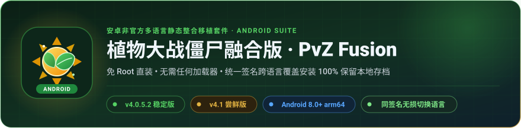

  
  
  
  
  

  &nbsp;&nbsp;
  &nbsp;&nbsp;
  

  🌐 <b>Switch Language / Đổi ngôn ngữ:</b> Click <b><a href="README.md">[EN] English</a></b> for English • Bấm <b><a href="README.vi.md">[VI] Bản Việt Hóa</a></b> để xem Tiếng Việt • 智能识别语言分享链接: <a href="https://heagon.github.io/pvz-fusion-english-android/">Smart Link</a>

  <a href="#downloads"><b>📥 下载专区</b></a> &nbsp;•&nbsp;
  <a href="#install"><b>🔄 覆盖安装与语言切换</b></a> &nbsp;•&nbsp;
  <a href="#highlights"><b>✨ 版本特性</b></a> &nbsp;•&nbsp;
  <a href="#screenshots"><b>📸 真机截图</b></a> &nbsp;•&nbsp;
  <a href="#guides"><b>📚 指南与常见问题</b></a> &nbsp;•&nbsp;
  <a href="#credits"><b>👥 致谢名单 (Credits)</b></a>

---

## 📥 APK 下载专区

> [!TIP]
> **统一签名 · 100% 无损保留存档：** 本仓库发布的所有安装包（**`[CN] 中文原版`**、**`[VI] 越化版`**、**`[EN] 英文版`**）均采用同一份项目官方签名证书（**Release Keystore**）打包。无论升级新版本还是在不同语言之间来回切换，只需**直接覆盖安装（点击更新）**——**切勿卸载旧版本**——即可 100% 完整保留全部通关进度、解锁植物与金币数据！

### 版本选择指南

| 版本号 | 发布通道 | 本地化完成度 | 适用人群建议 |
| :--- | :--- | :--- | :--- |
| **v4.0.5.2** | 🟢 **正式稳定版** | **`[CN]`** 原版 · **`[VI]`** 100% · **`[EN]`** 100% | **推荐绝大多数玩家下载。** 最稳定成熟的版本，全模式均已通过安卓真机排版校验。 |
| **v4.1 Preview** | 🟡 **尝鲜预览版** | **`[CN]`** 原版 · **`[VI]`** 100% 完整 · **`[EN]`** 界面覆盖 | 适合想抢先体验 **旅行进化（自走棋）**、**向日葵养殖**、**神笔马良** 及 **742 种植物** 的玩家。 |

---

### 🟢 v4.0.5.2 — 正式稳定版 *(全员推荐)*
完整更新日志与 SHA-256 校验码：**[查看 GitHub Release `v4.0.5.2`](https://github.com/Heagon/pvz-fusion-english-android/releases/tag/v4.0.5.2)**

| 语言版本 | 文件大小 | 版本说明 | 直接下载 |
| :--- | :---: | :--- | :---: |
| **`[CN]` 中文原版 (Raw)** | `591.1 MB` | 完整保留原作者 **蓝飘飘fly** 的原版代码、贴图与平衡性数值，采用统一签名打包，支持与越/英版本自由互切不丢档 |  |
| **`[VI]` Bản Việt Hóa (越化版)** | `599.6 MB` | 100% 完整越南语本地化（720 植物 / 235 僵尸 / 47 机制图鉴、48 张越化界面贴图、内置 `LiberationSans` 音调字体） |  |
| **`[EN]` English (英文版)** | `599.7 MB` | 100% 完整英文本地化（涵盖全部图鉴、关卡词条与 48 张英文界面贴图，针对手机端 uGUI 深度排版优化） |  |

---

### 🟡 v4.1 Preview — 自走棋远征与新内容尝鲜版
完整更新日志与 SHA-256 校验码：**[查看 GitHub Release `v4.1-half-translate`](https://github.com/Heagon/pvz-fusion-english-android/releases/tag/v4.1-half-translate)**

> [!NOTE]
> **v4.1 翻译进度说明：** **`[CN] 中文原版`** 为蓝飘飘fly 4.1 完整原版；**`[VI] 越化版`** 已完成 4.1 全量文本与贴图的 **100% 本地化**（新增 3,837 条文本与 48/48 张越化贴图）；**`[EN] 英文版`** 已完成 4.1 全部新增玩法界面（自走棋商店、刷新概率、全海克斯、向日葵养殖、神笔马良、编辑器帮助）的语境翻译，少量边缘图鉴条目仍在持续润色。

| 语言版本 | 文件大小 | 版本说明 | 直接下载 |
| :--- | :---: | :--- | :---: |
| **`[CN]` 中文原版 (Raw)** | `620.2 MB` | 蓝飘飘fly 原版 4.1 中文包，统一项目官方签名，可直接覆盖旧版或随时切回中文体验 |  |
| **`[VI]` Bản Việt Hóa (100% 越化版)** | `629.1 MB` | 4.1 完整 100% 越化版（全 742 植物 / 238 僵尸 / 48 机制、176 条新旅行词条、自走棋/养成/神笔/射击全覆盖、48/48 贴图越化） |  |
| **`[EN]` English (英文尝鲜版)** | `628.8 MB` | 4.1 英文尝鲜版（新增 994 条自走棋/向日葵养殖/神笔马良语境翻译，48/48 英文界面贴图，安卓真机排版校验） |  |

---

## 🔄 三步无损覆盖安装与语言切换指南

1. **下载安装包：** 在上方表格选择任意语言版本的 APK 下载至手机或平板（需 **Android 8.0+**、`arm64-v8a` 64 位架构、预留约 1.5 GB 存储空间）。
2. **直接覆盖安装：** 打开下载好的 APK，直接点击 **安装 / 更新** 覆盖当前设备上的游戏版本（**切勿卸载旧版本**）。
3. **启动即玩：** 新版本或新语言立即生效，**所有关卡进度、已解锁植物、禅境花园及金币存档（`playerData.json`）均 100% 无损保留！**

> [!IMPORTANT]
> **首次从其他第三方签名安装包迁移？** 若安卓系统提示 *“应用未安装（与现有软件包签名冲突）”*，请务必在卸载旧版**之前**将 `/sdcard/Android/data/com.LanPiaoPiao.PlantsVsZombiesRH/files/playerData.json` 备份到安全目录。详细步骤请参阅 **[存档备份与迁移指南 (`docs/MIGRATION.md`)](docs/MIGRATION.md#cn-简体中文)**。

### 📚 文档导航与故障排查中心

| 文档指南 | 内容概要 |
| :--- | :--- |
| 📖 **[安装指南与常见问题 (`docs/INSTALL.md`)](docs/INSTALL.md#cn-简体中文)** | 设备配置要求、未知来源应用授权、Play Protect / 手机管家提示说明，以及黑屏或植物冷却异常的系统区域排查方法。 |
| 🔄 **[无损更新与语言切换原理 (`docs/UPDATE.md`)](docs/UPDATE.md#cn-简体中文)** | 覆盖安装核心原则，以及动态更新 `unity_app_guid` 自动刷新 IL2CPP 元数据缓存的技术机制。 |
| 💾 **[存档备份与跨包迁移 (`docs/MIGRATION.md`)](docs/MIGRATION.md#cn-简体中文)** | 免 Root 在手机端（`MT 管理器` / `ZArchiver`）或电脑端（`adb`）备份与恢复 `playerData.json` 的完整教程。 |
| 🛠️ **[静态注入构建脚本 (`tools/README.md`)](tools/README.md)** | 公开透明的 Python 构建工具链（`UnityPy` 资源重打包、IL2CPP 字符串重构与 4 字节对齐重签名脚本）。 |
| 👥 **[完整致谢与来源 (`CREDITS.md`)](CREDITS.md#cn-简体中文)** | 致敬原版开发团队、多语言翻译社区、模组开发者、美术配乐作者及开源工具链。 |

---

## ✨ 项目简介与核心技术特性

本项目是《植物大战僵尸融合版》（*Plants vs. Zombies: Fusion* / PvZ RH）的**安卓非官方多语言静态整合移植套件**。不同于需要运行时插件加载器（`MelonLoader` / `BepInEx`）的 PC 端模组，本项目直接将社区翻译与贴图静态编译进安卓资源包与 IL2CPP 元数据中：

- **免折腾直装畅玩：** 免 Root、免电脑、无需任何外部 Mod 加载器或手动拷贝数据包，装好即玩。
- **三语自由无损互切：**
  - **`[CN]` 中文原版：** 100% 保持蓝飘飘fly原版内容与手感，统一签名方便多语玩家或语言学习者随时无损切回原版。
  - **`[VI]` 越化版：** 集成 `LiberationSans` 回退字库，完美渲染全部越南语复杂重音字符，完成全图鉴与 48 张界面贴图本地化。
  - **`[EN]` 英文版：** 完整移植 `PVZF-Translation` 社区成果并针对移动端屏幕深度调优字号与文本框边界，消除文字溢出。
- **存档安全保障机制：** 构建脚本自动根据每次补丁更新 `unity_app_guid`，确保安卓覆盖安装（`install -r`）后自动重新释放最新 `global-metadata.dat` 文本缓存，同时完整保留外部数据目录中的玩家存档。

---

## 📸 安卓真机实测截图对比

以下为安卓实体设备全模式校验实拍对比（左：**`[VI] 越化版`** · 右：**`[EN] 英文版`**）：

| `[VI]` 越化版实机画面 | `[EN]` 英文版实机画面 |
| :---: | :---: |
| **游戏主菜单 (`v4.0.5.2`)**  | **游戏主菜单 (`v4.0.5.2`)**  |
| **植物图鉴 (`v4.0.5.2`)** 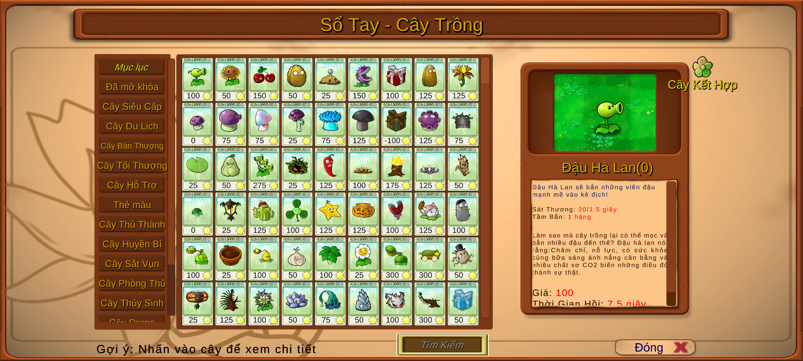 | **植物图鉴 (`v4.0.5.2`)** 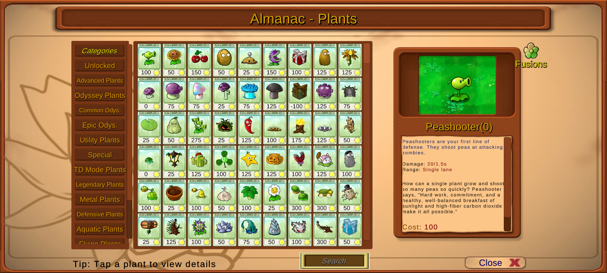 |
| **禅境花园 (`v4.0.5.2`)**  | **禅境花园 (`v4.0.5.2`)** 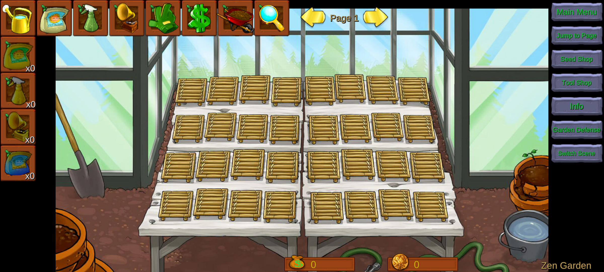 |
| **战斗与暂停菜单 (`v4.0.5.2`)** 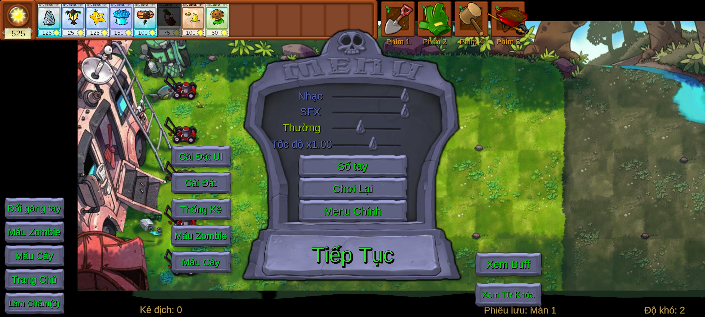 | **战斗与暂停菜单 (`v4.0.5.2`)**  |

<b>🧪 查看 v4.1 尝鲜版自走棋远征真机截图（VI / EN 对比）</b>

 

| `[VI]` 越化版 (`v4.1`) | `[EN]` 英文版 (`v4.1`) |
| :---: | :---: |
| **推荐关卡**  | **推荐关卡** 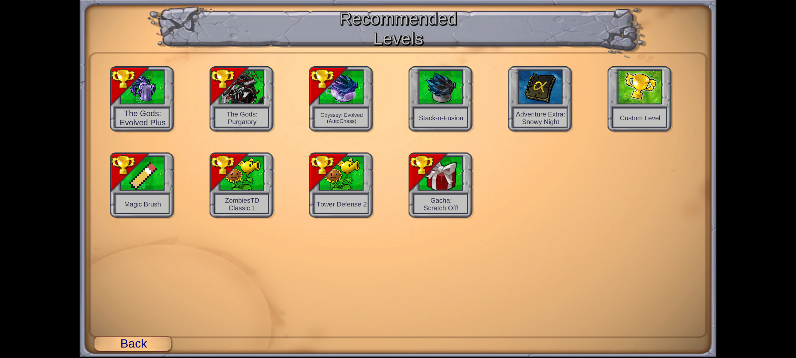 |
| **远征进化难度选择**  | **远征进化难度选择** 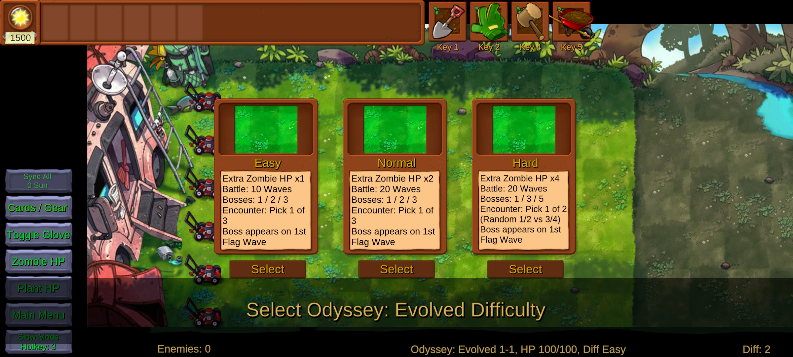 |
| **首领预览** 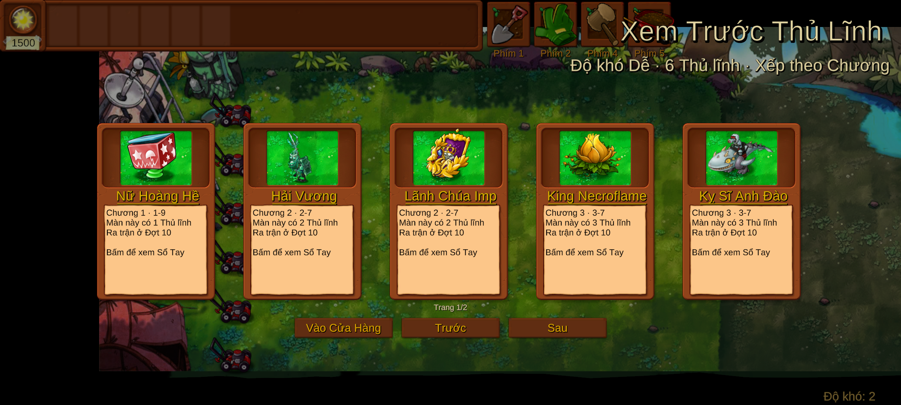 | **首领预览** 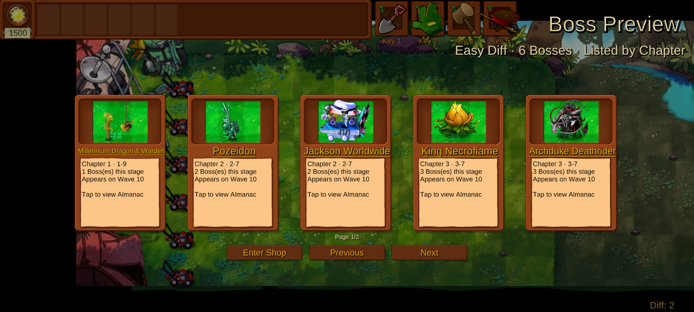 |
| **自走棋回合商店** 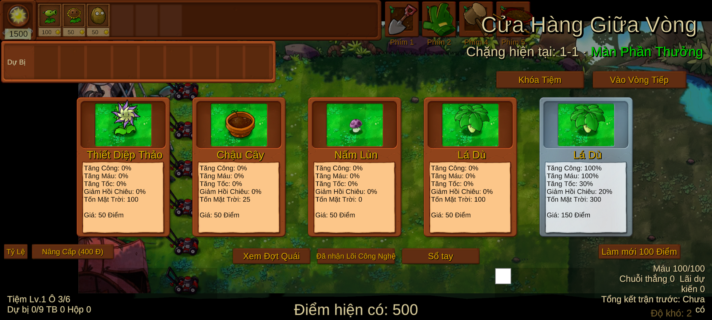 | **自走棋回合商店** 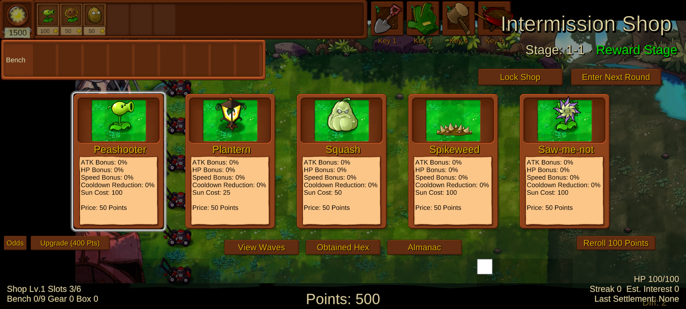 |

<b>🖼️ 查看更多 v4.0.5.2 游戏模式截图（生存、挑战、解谜、机制、词条等）</b>

 

| `[VI]` 越化版 | `[EN]` 英文版 |
| :---: | :---: |
| **生存模式** 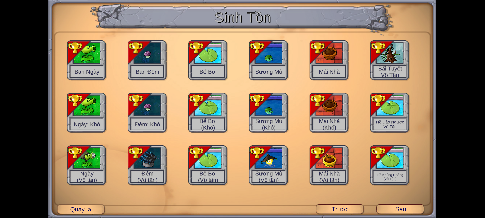 | **生存模式** 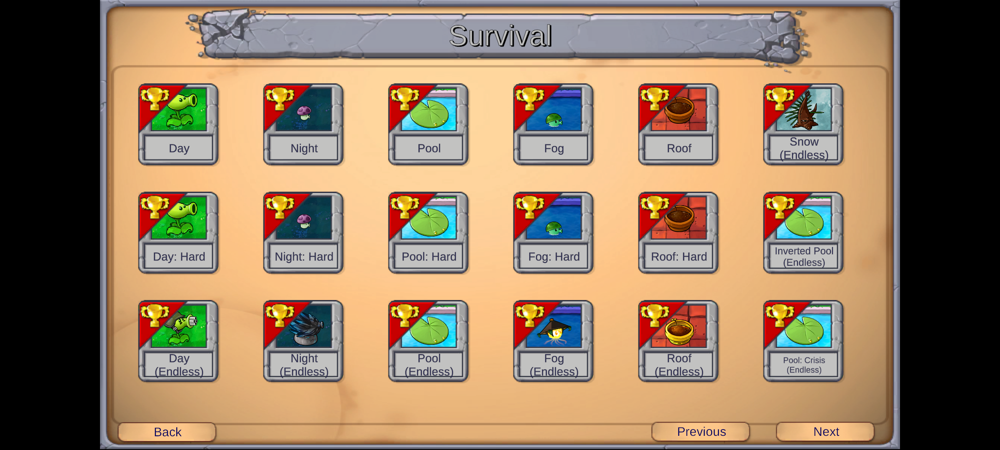 |
| **挑战模式** 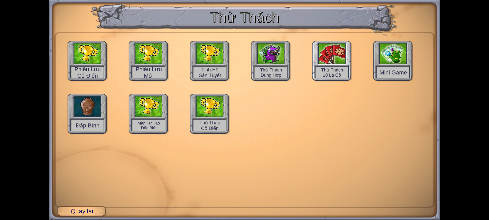 | **挑战模式** 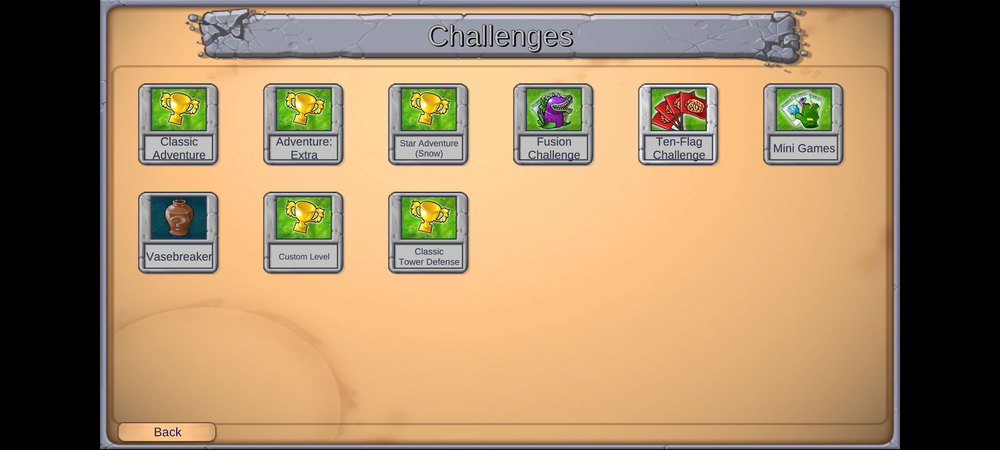 |
| **机制图鉴** 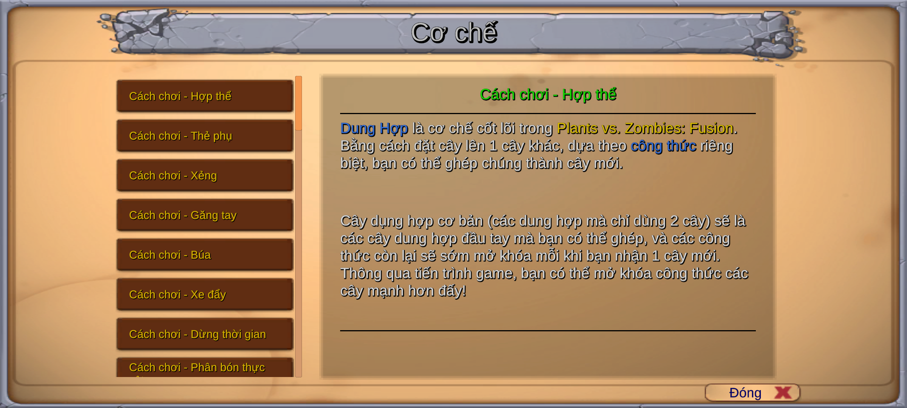 | **机制图鉴** 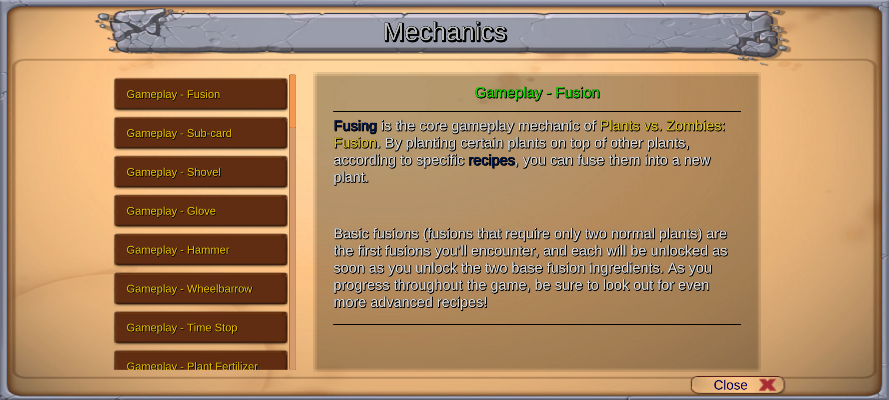 |
| **旅行词条图鉴**  | **旅行词条图鉴** 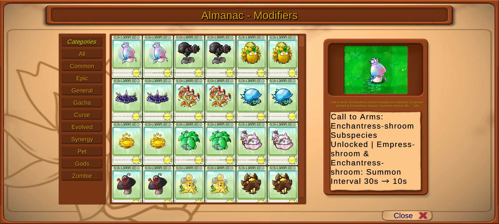 |
| **选卡界面** 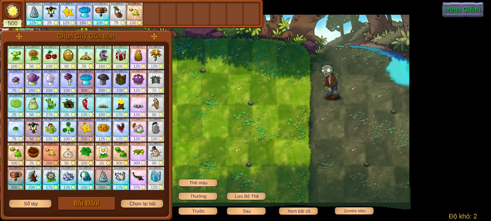 | **选卡界面** 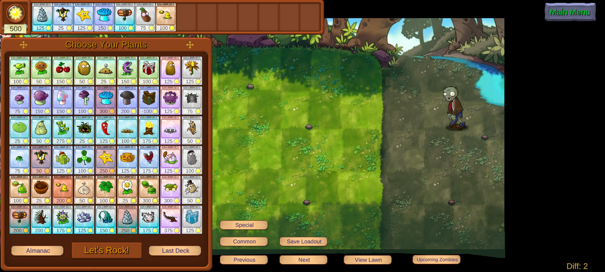 |
| **实机战斗画面** 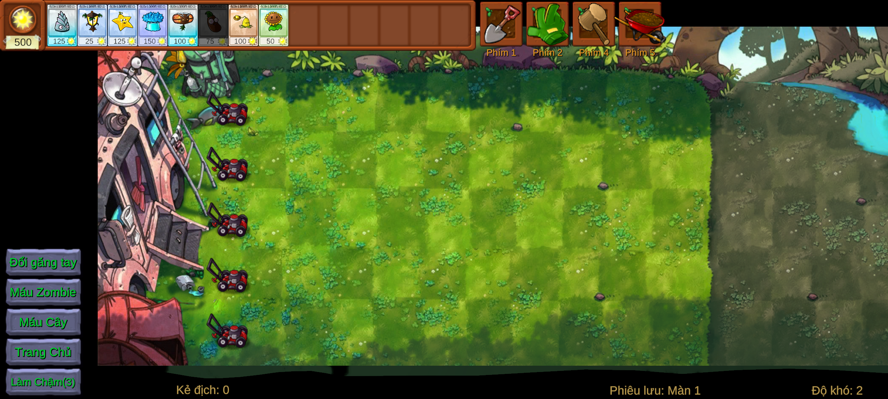 | **实机战斗画面** 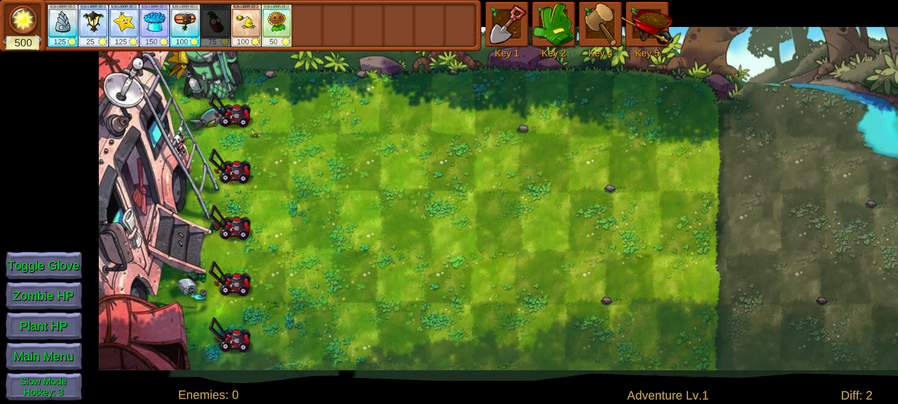 |

---

## 👥 致谢与来源名单 (Credits)

本安卓多语言整合套件的诞生离不开原版制作组与多语种本地化社区的无私付出。完整贡献者名录详见 **[CREDITS.md](CREDITS.md#cn-简体中文)**。

| 角色与模块 | 作者与贡献团队 | 官方链接与许可协议 |
| :--- | :--- | :--- |
| **原版游戏制作组** 《植物大战僵尸融合版》 (*PvZ: Fusion*) | • **蓝飘飘fly (LanPiaoPiaofly)** — 制作人、总策划、主程序、动画制作、美术与视觉导演 • **机鱼吐司 / 机鱼 (Gfishtus)** — 联合策划、主美与动画制作 • **蓝蝶 (LanDie)** — 动画与美术协助 • **梦珞 (MengLuo)** — 视频剪辑与后期制作 • **原版制作组特别鸣谢：** 北窗遥望、略nd、MC-大麦、潜艇伟伟迷、熔莹、射命丸文、使徒、Tip杨山木雁、小黄鸡、云耀yoke、庄不纯 | [哔哩哔哩官方主页](https://space.bilibili.com/3546619314178489) |
| **多语言模组与核心工程** (*PVZF-Translation*) | • **Mamoru-kun** — 英文主译者 • **NaKune** — 初代翻译模组作者 • **Climeron** — 代码逻辑支持与动态字体切换实现 • **Teyliu, Cassidy, JustNull, Dakosha** — 翻译模组程序开发与维护 • **TrevTV** — [MelonLoader-AudioTools](https://github.com/TrevTV/MelonLoader-AudioTools) 音频替换引擎 • **Rollerlhite** — [全新主菜单配乐](https://www.youtube.com/watch?v=aBj1MfvnHPE) • **Cassidy** — 英文版 *PvZ: Fusion* 标志设计 • **Roaoming, Shel, flexyj, CarrotD1scord, Xabdi** — 本地化界面贴图重绘与局内配乐 • **Blooms / The Blooms Community** — PC 端多语言整合包制作与翻译协作支持 | [PVZF-Translation 仓库](https://github.com/Teyliu/PVZF-Translation) · [翻译模组源码](https://github.com/Teyliu/PVZFusionTranslation) · [Discord 社区](https://discord.gg/DPAC5ZVJ8T) · [在线英文图鉴](https://carroti4ch.itch.io/almanac) 开源许可：**[CC BY-NC 4.0](https://creativecommons.org/licenses/by-nc/4.0/)** |
| **英文翻译与校对团队** | • **核心翻译：** Mamoru-kun, Cassidy, Ungoodapple, JustTer, Invis19 • **文本校对与润色：** TheXL, QwwYQ, Bertie690, revo • **往期贡献成员：** Dyna, Professor Cherry Zaitsev, Dimardan, IzzytehWolf, <code>&#124;&gt;.&lt;&#124;</code>, Diiax, Hetsuko, Metroidsans, Flow | [PVZF-Translation](https://github.com/Teyliu/PVZF-Translation) |
| **越南语本地化团队** (`Bản Việt Hóa`) | • **Team CBD &amp; Team Bloom** — 越南 PvZ Fusion 玩家社区本地化组 • **PVZF-Translation 越语成员：** Shion, Cryda, JustNull • **安卓 v4.0.5.2 &amp; v4.1 100% 完整越化补全：** Heagon（新增 3,837 条 4.1 文本、48/48 全量越化贴图及 `LiberationSans` 音调字库注入） | [PVZF-Translation](https://github.com/Teyliu/PVZF-Translation) |
| **安卓静态移植与自动化构建** | • **Heagon** — Unity 资源包与 IL2CPP 元数据静态注入管线、移动端 uGUI 排版调优、`unity_app_guid` 无损更新架构与统一 Release Keystore 签名维护 • **早期社区安卓移植致谢：** silvershadow ([pvzf-android-translation](https://github.com/silvershadowkat/pvzf-android-translation)), Joseph Franci • **开源构建工具链：** [UnityPy](https://github.com/K0lb3/UnityPy), [fontTools](https://github.com/fonttools/fonttools), [Pillow](https://python-pillow.org/), [Liberation Fonts](https://github.com/liberationfonts/liberation-fonts), [uber-apk-signer](https://github.com/patrickfav/uber-apk-signer) | [GitHub 项目主页](https://github.com/Heagon/pvz-fusion-english-android) |

---

## ⚖️ 版权归属与非商业免责声明

- **原作商标版权：** 《植物大战僵尸》（*Plants vs. Zombies*）及相关商标版权归 **Electronic Arts Inc. (EA) / PopCap Games** 所有。
- **翻译文本许可协议：** 来自 [PVZF-Translation](https://github.com/Teyliu/PVZF-Translation) 的社区本地化文本与贴图资源遵循 **[知识共享 署名-非商业性使用 4.0 国际许可协议 (CC BY-NC 4.0)](https://creativecommons.org/licenses/by-nc/4.0/)**，严禁任何形式的倒卖、付费分发或植入商业广告。
- **粉丝非盈利声明：** 本项目为社区爱好者维护的**完全免费、无广告、无内购、非商业**技术整合移植，按“原样”提供仅供学习交流使用。《植物大战僵尸融合版》同人游戏原作一切权利归 **蓝飘飘fly** 及其制作团队所有。
