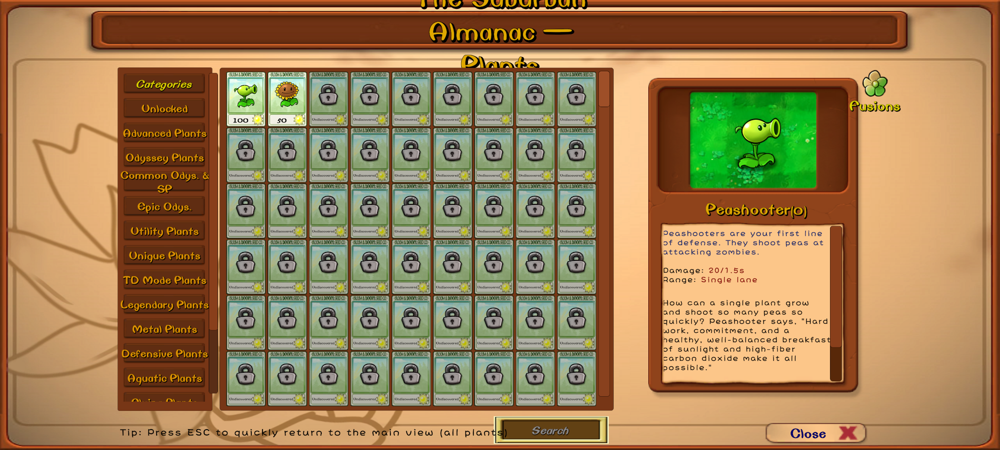
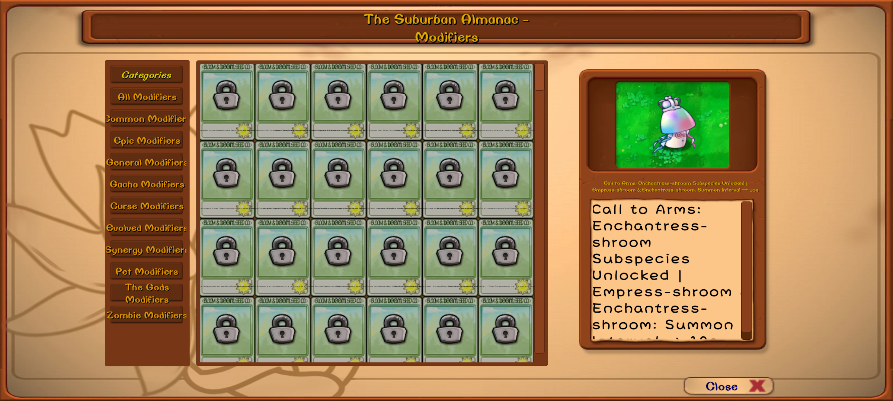

# Plants vs. Zombies: Fusion (Android) — Multi-Language Suite

An **unofficial Android localization and multi-language suite** for *Plants vs. Zombies: Fusion* (植物大战僵尸融合版), made by statically applying community translations to the original Android APK — **no root, no PC, no runtime mod loader required.**

Offering **Chinese (Raw/Gốc)**, **Tiếng Việt**, and **English** builds for both:
- **v4.0.5.2 (Latest Stable Release)**
- **v4.1 Preview (Half-Translated / Đang dịch dở)**

> ⚠️ **Fan-made & non-commercial.** This is a fan project. It is **not** affiliated with, endorsed by, or connected to the original game's developer (LanPiaoPiaofly), the translation teams, EA, or PopCap. All game content and translations belong to their respective creators — see **[Credits & Sources](#-credits--sources)**.

---

## 📥 Releases & Downloads

All APKs in this suite are signed with the project's official release keystore and verified with Android Signature Scheme v1, v2, and v3. Save files are preserved across updates and across language switches (`unity_app_guid` dynamic bump).

### 🌟 v4.0.5.2 (Latest Stable Multi-Language)
👉 **[View Release v4.0.5.2](../../releases/tag/v4.0.5.2)** | **[Bản riêng Tiếng Việt v4.0.5.2-vi](../../releases/tag/v4.0.5.2-vi)**

| Language / Ngôn ngữ | APK File | Size | SHA-256 Checksum | Description |
| :--- | :--- | :--- | :--- | :--- |
| 🇨🇳 **Chinese (Gốc / Raw)** | [`PvZ-Fusion-4.0.5.2-Chinese-Raw.apk`](../../releases/download/v4.0.5.2/PvZ-Fusion-4.0.5.2-Chinese-Raw.apk) | 591.1 MB | `51a084faf0eac1a8d633f7e4f0749441655a3d909df8befb71cc70d82fe0739a` | Bản gốc tiếng Trung của LanPiaoPiaofly (ký release key để đổi ngôn ngữ không mất save) |
| 🇻🇳 **Tiếng Việt** | [`PvZ-Fusion-4.0.5.2-Vietnamese.apk`](../../releases/download/v4.0.5.2/PvZ-Fusion-4.0.5.2-Vietnamese.apk) | 597.5 MB | `57d17659fff4147bd2f88458fe98f8c1f8065ed60a073fdc1fbd7fcba55039d5` | Bản Việt Hóa hoàn chỉnh (dịch từ tiếng Trung, font tiếng Việt 100%) |
| 🇬🇧 **English** | [`PvZ-Fusion-4.0.5.2-English.apk`](../../releases/download/v4.0.5.2/PvZ-Fusion-4.0.5.2-English.apk) | 599.5 MB | `aba29a346a6ecca587ce748b18568a12cfdbc4c990246d4ff35f7a4add4fb99c` | Complete English build (translated from Chinese) |

---

### ⚡ v4.1 Preview (Half-Translated / Đang dịch dở)
👉 **[View Release v4.1-half-translate](../../releases/tag/v4.1-half-translate)** | **[Bản riêng Tiếng Việt v4.1-vi-half-translate](../../releases/tag/v4.1-vi-half-translate)**

> [!WARNING]
> **Half-Translate / Đang dịch dở:** Bản thử nghiệm sớm cho PvZ Fusion 4.1. Các nội dung mới (AutoChess Thám hiểm Tiến Hóa, thực vật Tối Thượng mới, bùa chú) đang được dịch từ tiếng Trung gốc; các chuỗi chưa hoàn thiện sẽ tạm hiển thị tiếng Anh/bản dịch nháp để đảm bảo game không bị lỗi.

| Language / Ngôn ngữ | APK File | Size | SHA-256 Checksum | Description |
| :--- | :--- | :--- | :--- | :--- |
| 🇨🇳 **Chinese (Gốc / Raw)** | [`PvZ-Fusion-4.1-Chinese-Raw.apk`](../../releases/download/v4.1-half-translate/PvZ-Fusion-4.1-Chinese-Raw.apk) | 620.2 MB | `3144746c552455b88db28eedfa20777099ecdb9736ac679bbbe70cd4113cb5fd` | Bản gốc tiếng Trung 4.1 của LanPiaoPiaofly (ký release key để đổi ngôn ngữ không mất save) |
| 🇻🇳 **Tiếng Việt** | [`PvZ-Fusion-4.1-Vietnamese-HalfTranslate.apk`](../../releases/download/v4.1-half-translate/PvZ-Fusion-4.1-Vietnamese-HalfTranslate.apk) | 626.7 MB | `83fad03cf196195727c6eaf540f299be9f2133cc41e778016c99dd420d0b6dd6` | Bản Việt Hóa 4.1 Preview (Half-Translate, dịch từ tiếng Trung) |
| 🇬🇧 **English** | [`PvZ-Fusion-4.1-English-HalfTranslate.apk`](../../releases/download/v4.1-half-translate/PvZ-Fusion-4.1-English-HalfTranslate.apk) | 628.6 MB | `f9fd984f1647a442756a5021cdcddaa2bcf8fe9db8785a0ce9581e6768a865b2` | English 4.1 Preview build (Half-Translate, translated from Chinese) |

---

## 🔄 Hướng Dẫn Đổi Ngôn Ngữ Không Mất Save (In-Place Language Switching)

Tất cả các bản APK trong bộ sưu tập (Tiếng Trung gốc, Tiếng Việt, Tiếng Anh) đều dùng chung **Release Keystore chính thức** của dự án. Nhờ vậy, bạn có thể dễ dàng chuyển đổi ngôn ngữ giống như cơ chế restart game:

1. **Khi muốn đổi ngôn ngữ:** Bạn chỉ cần tải file APK của ngôn ngữ mong muốn (ví dụ đang ở Tiếng Anh muốn sang Tiếng Việt hoặc về Tiếng Trung gốc).
2. **Cài đè (Install / Update):** Mở file APK mới và bấm Cập nhật đè lên bản cũ (không cần gỡ cài đặt).
3. **Mở lại game:** Ngôn ngữ mới sẽ được áp dụng ngay lập tức, và **toàn bộ dữ liệu cày cuốc, cây cối, tiền vàng, màn chơi (`playerData.json`) được giữ nguyên vẹn 100%!**

---

## 🇻🇳 Thông Tin Bản Tiếng Việt (Vietnamese Details)

- **Hỗ trợ 100% tiếng Việt có dấu:** Hệ thống tự động cấu hình font dự phòng `LiberationSans` trong asset bundle `data.unity3d`, giúp toàn bộ các ký tự có dấu (`ừ, ỡ, ệ, ằ, ú, ắ, â, ĩ, ô, ễ...`) hiển thị sắc nét, không bị lỗi mất ký tự hay ô vuông `[]`.
- **Dịch trực tiếp từ tiếng Trung:**
  - Đầy đủ 720/720 thực vật (bản 4.0.5.2) và 742/742 thực vật (bản 4.1).
  - Đầy đủ 235/235 zombie (bản 4.0.5.2) và 238/238 zombie (bản 4.1).
  - Đầy đủ 47/47 cơ chế (bản 4.0.5.2) và 48/48 cơ chế (bản 4.1, bao gồm Đinh ba Biển sâu).
- **Việt hóa Giao diện:** Toàn bộ menu, nút bấm, bảng kết thúc màn chơi, bảng chọn độ khó, HUD, thông báo trong trận và hệ thống bùa Thám hiểm (Travel Buffs).
- **Đồ họa:** Thay thế 38+ kết cấu hình ảnh menu sang tiếng Việt.

---

## 📸 Screenshots

| Main menu | Almanac |
|---|---|
|  |  |
| **Mechanics** | **Modifiers** |
|  |  |

---

## 🙏 Credits & Sources

This project exists thanks to the dedicated work of the community:

| Role | Contributor | Links |
|---|---|---|
| **Original Game Creator** (*PvZ Fusion* / 植物大战僵尸融合版) | **LanPiaoPiaofly (蓝飘飘fly)** | [Bilibili](https://space.bilibili.com/3546619314178489) |
| **English Translation** | **PVZF‑Translation Team** | [GitHub](https://github.com/Teyliu/PVZF-Translation) · [Discord](https://discord.gg/DPAC5ZVJ8T) |
| **Vietnamese Translation (Bản Việt Hóa)** | **Team CBD & Team Bloom** | [PVZF-Translation / Vietnamese](https://github.com/Teyliu/PVZF-Translation) |
| **Android Porting & Automation** | **Heagon** | [GitHub Repo](https://github.com/Heagon/pvz-fusion-english-android) |

---

## ⚖️ License & Disclaimer

- *Plants vs. Zombies* is a registered trademark of **Electronic Arts / PopCap Games**.
- This project is an unofficial fan port, non-commercial, and free of charge. No monetisation or ads.
- Distributed "as is" with no warranty.
