

  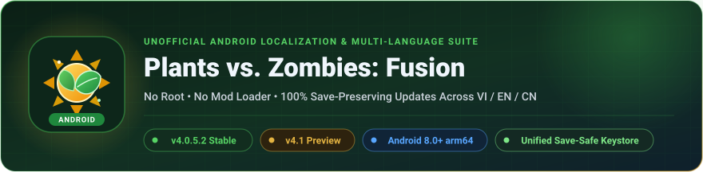

  
  
  
  
  
  

  &nbsp;&nbsp;
  &nbsp;&nbsp;
  

  🌐 <b>Đổi ngôn ngữ trang / 切换页面语言:</b> Bấm <b><a href="README.vi.md">[VI] Bản Việt Hóa</a></b> để xem Tiếng Việt • 点击 <b><a href="README.cn.md">[CN] 简体中文</a></b> 查看中文说明 • Smart Share Link: <a href="https://heagon.github.io/pvz-fusion-english-android/">Auto-Language Link</a>

  <a href="#downloads"><b>📥 Downloads</b></a> &nbsp;•&nbsp;
  <a href="#install"><b>🔄 Install &amp; Switch Language</b></a> &nbsp;•&nbsp;
  <a href="#highlights"><b>✨ Highlights</b></a> &nbsp;•&nbsp;
  <a href="#screenshots"><b>📸 Screenshots</b></a> &nbsp;•&nbsp;
  <a href="#guides"><b>📚 Guides &amp; FAQ</b></a> &nbsp;•&nbsp;
  <a href="#credits"><b>👥 Credits</b></a>

---

## 📥 APK Downloads

> [!TIP]
> **100% Save-Preserving Architecture:** Every APK in this repository (**`[EN] English`**, **`[VI] Bản Việt Hóa`**, and **`[CN] Chinese Raw`**) is signed with the same official **Release Keystore**. Simply **install over your existing app (Update)** — **never uninstall** — to update versions or switch languages anytime without losing progress!

### Which Version Should You Choose?

| Release | Channel | Localization Coverage | Best For |
| :--- | :--- | :--- | :--- |
| **v4.0.5.2** | 🟢 **Latest Stable** | **`[EN]`** 100% · **`[VI]`** 100% · **`[CN]`** Original | **Recommended for most players.** Thoroughly tested across all game modes with complete translations. |
| **v4.1 Preview** | 🟡 **Early Preview** | **`[EN]`** Contextual UI · **`[VI]`** 100% · **`[CN]`** Original | Players eager to try **Odyssey: Evolved (AutoChess)**, **Sunflower Breeding (Tycoon)**, **Magic Brush**, and **742 plants**. |

---

### 🟢 v4.0.5.2 (`B.0.1`) — Latest Stable *(Recommended)*
Full release notes & SHA-256 checksums: **[GitHub Release `v4.0.5.2-B.0.1`](https://github.com/Heagon/pvz-fusion-english-android/releases/tag/v4.0.5.2-B.0.1)** · Build history &amp; rollback archive: **[`CHANGELOG.md`](CHANGELOG.md)**

| Edition | Size | Summary | Direct Download |
| :--- | :---: | :--- | :---: |
| **`[EN]` English** | `599.7 MB` | Complete English localization (720 plants, 235 zombies, 47 mechanics, 48 UI textures, mobile uGUI layout verified) |  |
| **`[VI]` Bản Việt Hóa** | `599.6 MB` | Complete Vietnamese localization (100% accented `LiberationSans` font, full Almanac & 48 localized UI textures) |  |
| **`[CN]` 中文原版 (Raw)** | `591.1 MB` | Untouched original Chinese build by **蓝飘飘fly**, re-signed with the unified keystore for seamless switching |  |

---

### 🟡 v4.1 Preview (`B.0.3` / `B.0.2`) — Odyssey: Evolved (AutoChess) &amp; New Content
Full release notes & SHA-256 checksums: **[GitHub Release `v4.1-half-translate-B.0.3`](https://github.com/Heagon/pvz-fusion-english-android/releases/tag/v4.1-half-translate-B.0.3)** · **[`B.0.2` (`EN`)](https://github.com/Heagon/pvz-fusion-english-android/releases/tag/v4.1-half-translate-B.0.2)** · Build history: **[`CHANGELOG.md`](CHANGELOG.md)**

> [!NOTE]
> **v4.1 Preview Status:** The **`[EN] English`** build (`B.0.2`) includes full contextual UI translations for all new v4.1 modes (*Odyssey: Evolved AutoChess*, *Intermission Shop*, *Hex Augments*, *Sunflower Breeding / Tycoon*, *Magic Brush*, and *Level Creator Help*) verified on Android, while minor edge Almanac strings continue to be refined. The **`[VI] Bản Việt Hóa`** build (`B.0.3`) is **100% localized** and includes the Android 13 / Nubia `TalentNode` startup crash fix.

| Edition | Size | Summary | Direct Download |
| :--- | :---: | :--- | :---: |
| **`[EN]` English (`B.0.2`)** | `628.8 MB` | Contextual v4.1 English UI (+994 new strings, AutoChess Shop/Hexes/Tycoon/Magic Brush, 48/48 UI textures) |  |
| **`[VI]` Bản Việt Hóa (`B.0.3`)** | `629.0 MB` | 100% complete v4.1 Vietnamese build (742/742 plants, 238/238 zombies, 48/48 mechanics, 176 Travel Buffs, 48/48 VI textures, Android 13 crash fix) |  |
| **`[CN]` 中文原版 (`B.0.1`)** | `620.2 MB` | Untouched v4.1 Chinese build by **蓝飘飘fly**, signed with the unified keystore for lossless switching |  |

---

## 🔄 3-Step Installation &amp; Language Switching

1. **Download APK:** Pick any build (`[EN]`, `[VI]`, or `[CN]`) from the tables above on your Android phone or tablet (**Android 8.0+**, `arm64-v8a`, ~1.5 GB free storage).
2. **Install Over Existing App:** Open the downloaded APK and tap **Install / Update** directly over your existing installation (**DO NOT uninstall** the previous app).
3. **Launch &amp; Play:** Your chosen version/language loads immediately, and **100% of your unlocked plants, coins, Zen Garden, and stage progress (`playerData.json`) remain intact!**

> [!IMPORTANT]
> **Switching from a third-party APK for the first time?** If Android reports an *"App not installed (package conflicts with an existing package)"* signature mismatch, back up `/sdcard/Android/data/com.LanPiaoPiao.PlantsVsZombiesRH/files/playerData.json` **before** uninstalling the old app. Follow the step-by-step **[Save Data Backup &amp; Migration Guide (`docs/MIGRATION.md`)](docs/MIGRATION.md)**.

### 📚 Documentation &amp; Troubleshooting Hub

| Guide | What It Covers |
| :--- | :--- |
| 📖 **[Installation &amp; Troubleshooting (`docs/INSTALL.md`)](docs/INSTALL.md)** | Device requirements, Unknown Sources setup, Google Play Protect prompt, and fixing black screens / abnormal cooldowns caused by system locale. |
| 🔄 **[Safe Updates &amp; Language Switching (`docs/UPDATE.md`)](docs/UPDATE.md)** | Golden rule for lossless updates and how `unity_app_guid` refreshes IL2CPP localization cache automatically. |
| 📋 **[Build History &amp; Release Changelog (`CHANGELOG.md`)](CHANGELOG.md)** | Complete `B.<major>.<minor>` build timeline, exact fixes per build, SHA-256 checksums, and immutable rollback links. |
| 💾 **[Save Backup &amp; Migration (`docs/MIGRATION.md`)](docs/MIGRATION.md)** | How to back up and restore `playerData.json` on-device (`ZArchiver` / `MT Manager`) or via PC (`adb`) with zero root required. |
| 🛠️ **[Build Pipeline &amp; Scripts (`tools/README.md`)](tools/README.md)** | Open-source static Unity asset &amp; IL2CPP metadata patching tools for transparency and reproducible builds. |
| 👥 **[Complete Credits &amp; Sources (`CREDITS.md`)](CREDITS.md)** | Full Hall of Fame honoring the original creators, translators, mod engineers, artists, and open-source tools. |

---

## ✨ Project Overview &amp; Technical Highlights

This project is an **unofficial static Android localization suite** for *Plants vs. Zombies: Fusion* (*植物大战僵尸融合版*). Unlike PC mods that require runtime loaders (`MelonLoader` / `BepInEx`), translations and textures are compiled directly into the Android asset bundle and IL2CPP metadata:

- **Zero Setup Friction:** Works out of the box on standard Android devices — **no root, no PC, no runtime mod loader, and no external OBB copying**.
- **Comprehensive Game Coverage:**
  - **Almanac:** Up to **742 Plants**, **238 Zombies**, and **48 Mechanics** localized with adjusted mobile `<size>` tags so descriptions fit cleanly without clipping.
  - **UI &amp; Gameplay Modes:** Main menus, settings, Adventure, Survival, Challenges, Puzzles, Zen Garden, Harvest/Mystery Mode, Odyssey Travel Buffs, and v4.1 *Odyssey: Evolved (AutoChess)*, *Tycoon*, &amp; *Magic Brush*.
  - **Localized Textures:** **48/48 UI textures** replaced (wooden signboards, mode banners, wave progress meters) and verified on real Android hardware.
- **Mobile Typography &amp; Save Safety:**
  - Optimized uGUI text bounds to prevent mobile button/card overflow, plus `LiberationSans` fallback injection for crisp diacritic rendering in `[VI]`.
  - Automatic `unity_app_guid` cache invalidation ensures Unity IL2CPP extracts updated `global-metadata.dat` strings cleanly on `install -r` without wiping user data.

---

## 📸 Real Android Device Screenshots

Verified on physical Android hardware across all game modes:

| Main Menu (`v4.0.5.2-B.0.1`) | Plants Almanac (`v4.0.5.2-B.0.1`) |
| :---: | :---: |
| 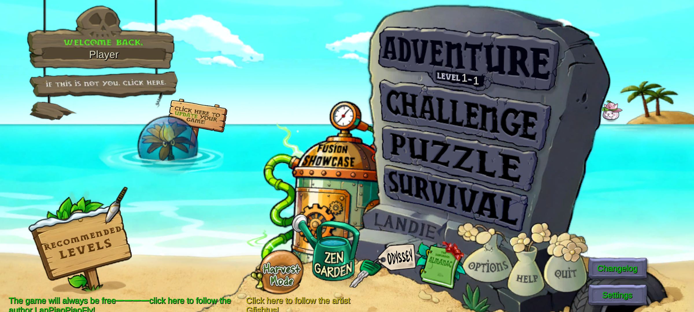 |  |
| **Zen Garden (`v4.0.5.2-B.0.1`)** | **Battle HUD &amp; Pause Menu (`v4.0.5.2-B.0.1`)** |
| 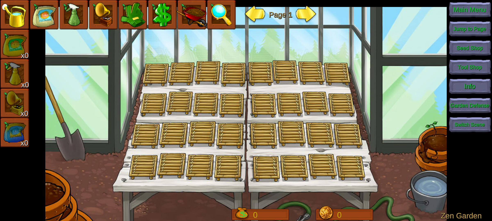 | 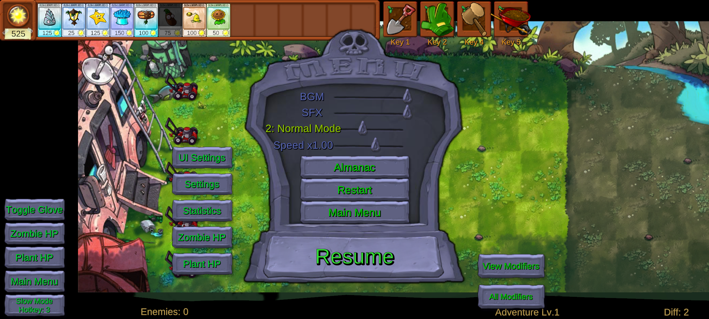 |

<b>🖼️ View All v4.0.5.2 Game Mode Screenshots (11 Additional Screens)</b>

 

| Game Mode | Game Mode |
| :---: | :---: |
| **Settings** 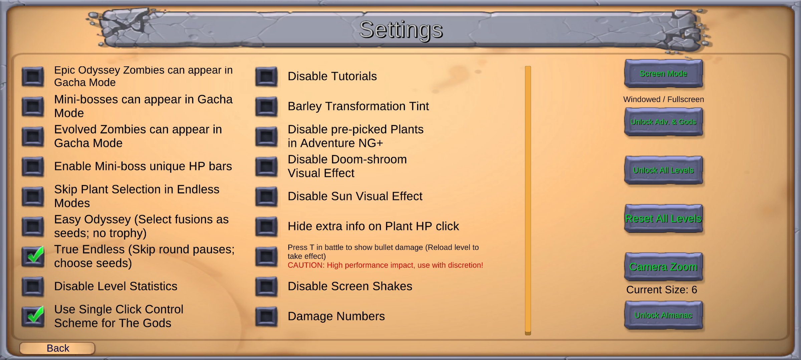 | **Survival Mode**  |
| **Challenge Mode** 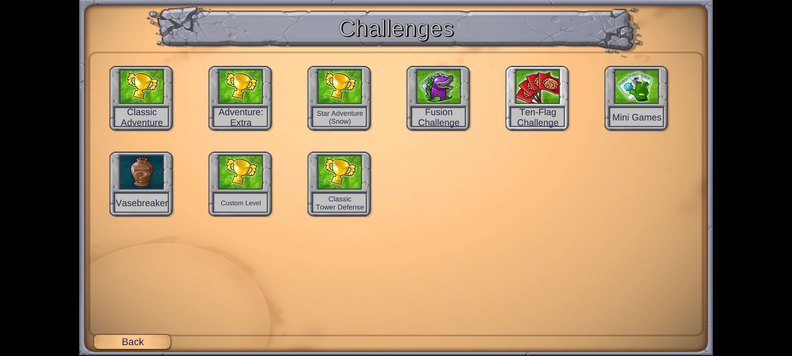 | **Puzzle Mode** 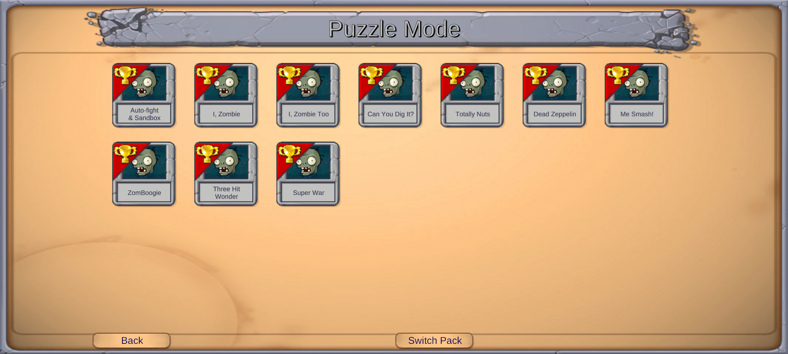 |
| **Recommended Levels** 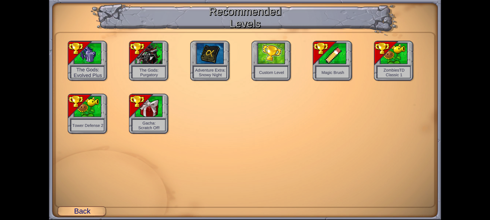 | **Zombies Almanac** 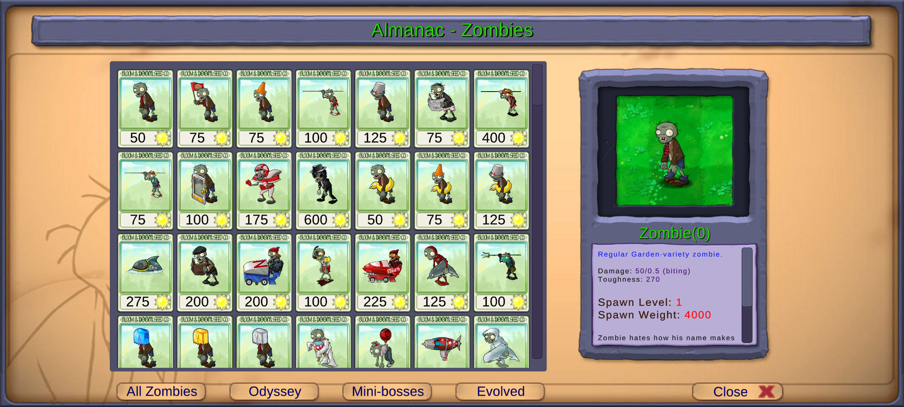 |
| **Mechanics Almanac**  | **Modifiers / Buffs Almanac** 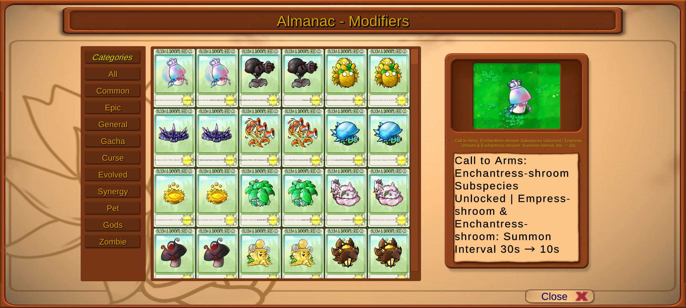 |
| **Odyssey: Challenges** 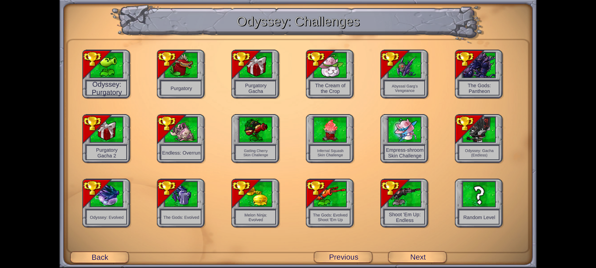 | **Harvest / Mystery Mode** 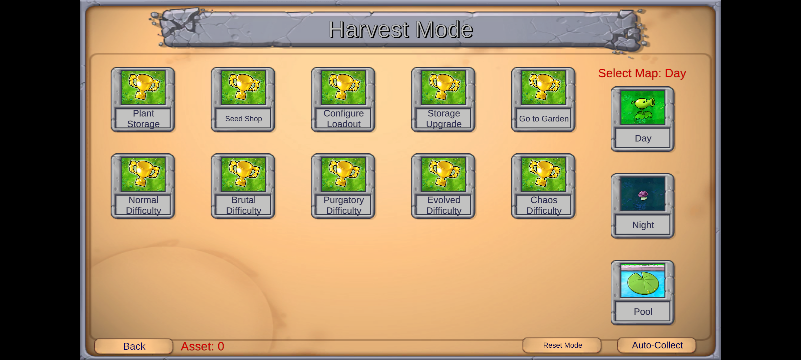 |
| **Seed Selection** 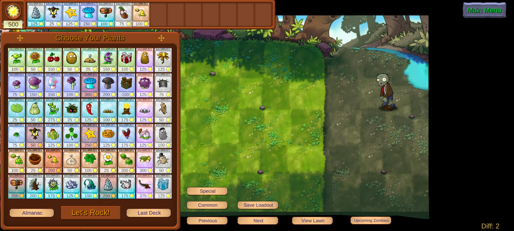 | **In-Battle HUD**  |

<b>🧪 View v4.1 Preview Screenshots (Odyssey: Evolved AutoChess, Boss Preview &amp; Shop)</b>

 

| v4.1 Preview Screen | v4.1 Preview Screen |
| :---: | :---: |
| **Recommended Levels (`v4.1`)**  | **Save File Picker (`v4.1`)** 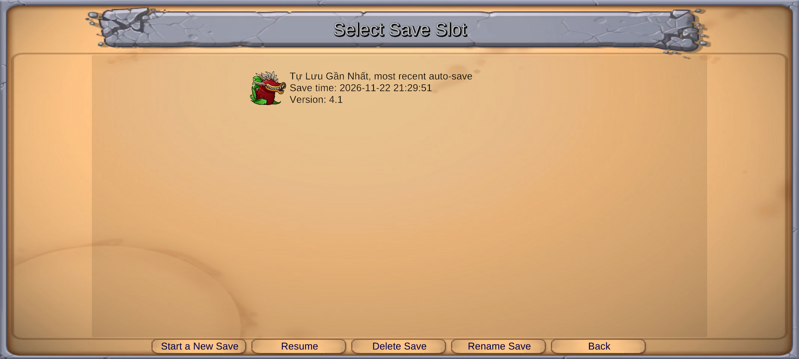 |
| **AutoChess Difficulty Selection**  | **AutoChess Boss Preview**  |
| **AutoChess Intermission Shop**  | **Main Menu (`v4.1`)** 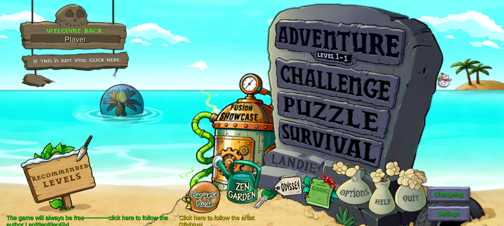 |

<b>🌏 Preview [VI] Bản Việt Hóa Screenshots (Side-by-Side Sample)</b>

 

| `[VI]` Main Menu (`v4.0.5.2-B.0.1`) | `[VI]` v4.1 AutoChess Shop |
| :---: | :---: |
|  |  |

> 👉 See all Vietnamese screenshots on **[`[VI]` Bản Việt Hóa (`README.vi.md`)](README.vi.md)**.

---

## 👥 Credits &amp; Acknowledgements

This Android suite stands on the creativity and dedication of the original developers and localization communities. Full contributor details are documented in **[CREDITS.md](CREDITS.md)**.

| Category / Role | Creators &amp; Contributors | Official Links &amp; License |
| :--- | :--- | :--- |
| **Original Game** *Plants vs. Zombies: Fusion* (植物大战僵尸融合版) | • **LanPiaoPiaofly (蓝飘飘fly)** — Creator, Producer, Game Design, Programming, Animation &amp; Visual Direction • **Gfishtus / JiYuTuSi (机鱼吐司 / 机鱼)** — Co-Designer, Lead Art &amp; Animation • **LanDie (蓝蝶)** — Animation &amp; Art Assistant • **MengLuo (梦珞)** — Video Production &amp; Editing • **Special Thanks:** 北窗遥望, 略nd, MC-大麦, 潜艇伟伟迷, 熔莹, 射命丸文, 使徒, Tip杨山木雁, 小黄鸡, 云耀yoke, 庄不纯 | [Bilibili Official Space](https://space.bilibili.com/3546619314178489) |
| **Multi-Language Mod &amp; Core Engineering** (*PVZF-Translation*) | • **Mamoru-kun** — Main English Translator • **NaKune** — Original Translation Mod Creator • **Climeron** — Code Support &amp; Font Changing Implementation • **Teyliu, Cassidy, JustNull, Dakosha** — Mod Programming &amp; Maintenance • **TrevTV** — [MelonLoader-AudioTools](https://github.com/TrevTV/MelonLoader-AudioTools) Audio Engine • **Rollerlhite** — [Custom Main Menu Music](https://www.youtube.com/watch?v=aBj1MfvnHPE) • **Cassidy** — English *PvZ: Fusion* Logo • **Roaoming, Shel, flexyj, CarrotD1scord, Xabdi** — Custom/Translated UI Textures &amp; In-Game Music • **Blooms / The Blooms Community** — Multi-Language PC Packaging &amp; Translation Support | [PVZF-Translation](https://github.com/Teyliu/PVZF-Translation) · [Translator DLL](https://github.com/Teyliu/PVZFusionTranslation) · [Discord](https://discord.gg/DPAC5ZVJ8T) · [Online Almanac](https://carroti4ch.itch.io/almanac) License: **[CC BY-NC 4.0](https://creativecommons.org/licenses/by-nc/4.0/)** |
| **English Translation &amp; Proofreading Team** | • **Translators:** Mamoru-kun, Cassidy, Ungoodapple, JustTer, Invis19 • **Proofreading &amp; Correction:** TheXL, QwwYQ, Bertie690, revo • **Past Contributors:** Dyna, Professor Cherry Zaitsev, Dimardan, IzzytehWolf, <code>&#124;&gt;.&lt;&#124;</code>, Diiax, Hetsuko, Metroidsans, Flow | [PVZF-Translation](https://github.com/Teyliu/PVZF-Translation) |
| **Vietnamese Localization** (`Bản Việt Hóa`) | • **Team CBD &amp; Team Bloom** — PvZ Fusion Vietnam Community • **PVZF-Translation VI Team:** Shion, Cryda, JustNull • **v4.0.5.2 &amp; v4.1 Android Completion:** Heagon (+3,837 v4.1 strings, 48/48 VI textures &amp; `LiberationSans` accented font integration) | [PVZF-Translation](https://github.com/Teyliu/PVZF-Translation) |
| **Android Porting, v4.1 Suite &amp; Automation** | • **Heagon** — Static Unity bundle &amp; IL2CPP metadata patching pipeline, mobile uGUI layout polish, `unity_app_guid` save-safe updates &amp; unified Release Keystore • **Prior Community Android Porters:** silvershadow ([pvzf-android-translation](https://github.com/silvershadowkat/pvzf-android-translation)), Joseph Franci • **Open-Source Tooling:** [UnityPy](https://github.com/K0lb3/UnityPy), [fontTools](https://github.com/fonttools/fonttools), [Pillow](https://python-pillow.org/), [Liberation Fonts](https://github.com/liberationfonts/liberation-fonts), [uber-apk-signer](https://github.com/patrickfav/uber-apk-signer) | [GitHub Repository](https://github.com/Heagon/pvz-fusion-english-android) |

---

## ⚖️ License &amp; Non-Commercial Disclaimer

- **Franchise Trademark:** *Plants vs. Zombies* is a registered trademark and copyright of **Electronic Arts Inc. (EA) / PopCap Games**.
- **Translation License:** Upstream community translation files from [PVZF-Translation](https://github.com/Teyliu/PVZF-Translation) are licensed under **[Creative Commons Attribution-NonCommercial 4.0 International (CC BY-NC 4.0)](https://creativecommons.org/licenses/by-nc/4.0/)**. Commercial redistribution, paid mirrors, or ad-monetized repacks are strictly prohibited.
- **Fan Project Notice:** This repository is a **100% free, non-commercial, ad-free fan localization project** distributed *"as is"* without warranty for community accessibility. All rights to the base fan game belong to **蓝飘飘fly** and team.
