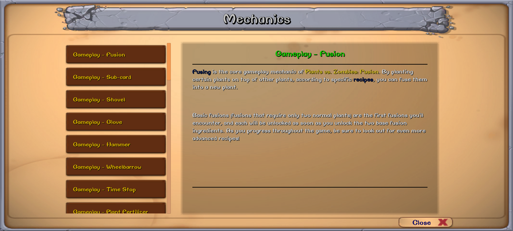

# Plants vs. Zombies: Fusion (Android) — Multi-Language Suite

An **unofficial Android localization and multi-language suite** for *Plants vs. Zombies: Fusion* (植物大战僵尸融合版), made by statically applying community translations to the original Android APK — **no root, no PC, no runtime mod loader required.**

Cung cấp đầy đủ các bản: **Bản Việt Hóa**, **English**, và **中文原版 (Chinese Raw)** cho cả hai phiên bản:
- **v4.0.5.2 (Latest Stable Release / Bản chính thức ổn định)**
- **v4.1 Preview (Half-Translated / Bản thử nghiệm dịch tự động)**

> ⚠️ **Fan-made & non-commercial.** This is a fan project. It is **not** affiliated with, endorsed by, or connected to the original game's developer (LanPiaoPiaofly), the translation teams, EA, or PopCap. All game content and translations belong to their respective creators — see **[Credits & Sources](#-credits--sources)**.

---

## 📥 Releases & Downloads

Dưới đây là toàn cảnh các phiên bản PvZ Fusion Android được phát hành. Tất cả các bản APK đều được ký bằng cùng một **Release Keystore chính thức**, đảm bảo **không bao giờ bị mất dữ liệu chơi (save game)** khi bạn cập nhật hoặc chuyển đổi qua lại giữa các ngôn ngữ.

| Phiên bản / Version / 版本 | Trạng thái / Status | Ngôn ngữ hỗ trợ | Khuyến nghị / Recommendation |
| :--- | :--- | :--- | :--- |
| **v4.0.5.2** | 🟢 **Latest Stable** | 🇻🇳 Bản Việt Hóa · 🇬🇧 English · 🇨🇳 中文原版 | **Khuyên dùng cho mọi người chơi.** Bản ổn định nhất, đã dịch và kiểm thử hoàn chỉnh 100%. |
| **v4.1 Preview** | 🟡 **Half-Translate** | 🇻🇳 Bản Việt Hóa · 🇬🇧 English · 🇨🇳 中文原版 | Dành cho người muốn trải nghiệm sớm tính năng mới (AutoChess, cây mới). Dịch tự động từ tiếng Trung. |

---

### 🟢 v4.0.5.2 (Bản chính thức — Đã dịch hoàn thiện / Fully Translated / 完整翻译)
👉 **[Xem trang Release v4.0.5.2 trên GitHub](../../releases/tag/v4.0.5.2)**

| Ngôn ngữ / Language / 语言 | Tải về / APK Download / 下载 | Dung lượng / Size | Ghi chú / Notes / 说明 |
| :--- | :--- | :--- | :--- |
| 🇻🇳 **Bản Việt Hóa** | [Tải APK Bản Việt Hóa](../../releases/download/v4.0.5.2/PvZ-Fusion-4.0.5.2-Vietnamese.apk) | 597.5 MB | Bản Việt Hóa hoàn chỉnh (dịch chuẩn từ tiếng Trung, font tiếng Việt 100%) |
| 🇬🇧 **English** | [Download APK (English)](../../releases/download/v4.0.5.2/PvZ-Fusion-4.0.5.2-English.apk) | 599.5 MB | Complete English build (translated from Chinese) |
| 🇨🇳 **中文原版 (Chinese Raw)** | [下载原版 APK (Chinese)](../../releases/download/v4.0.5.2/PvZ-Fusion-4.0.5.2-Chinese-Raw.apk) | 591.1 MB | 蓝飘飘fly 原版中文（官方签名，可与各语言版相互覆盖不丢存档） |

---

### 🟡 v4.1 Preview (Bản thử nghiệm — Dịch tự động / Đang hoàn thiện / 尝鲜版)
👉 **[Xem trang Release v4.1 Preview trên GitHub](../../releases/tag/v4.1-half-translate)**

> [!NOTE]
> **Half-Translate / Dịch tự động:** Phiên bản thử nghiệm sớm dành cho PvZ Fusion 4.1 (chế độ Thám hiểm Tiến Hóa AutoChess, cây Tối Thượng mới). Các nội dung mới đang được dịch tự động từ tiếng Trung gốc; các chuỗi chưa hoàn thiện sẽ tạm hiển thị tiếng Anh/bản dịch nháp để đảm bảo game vận hành ổn định không bị văng lỗi.

| Ngôn ngữ / Language / 语言 | Tải về / APK Download / 下载 | Dung lượng / Size | Ghi chú / Notes / 说明 |
| :--- | :--- | :--- | :--- |
| 🇻🇳 **Bản Việt Hóa** | [Tải APK Bản Việt Hóa](../../releases/download/v4.1-half-translate/PvZ-Fusion-4.1-Vietnamese-HalfTranslate.apk) | 626.7 MB | Bản Việt Hóa 4.1 Preview (Half-Translate, dịch từ tiếng Trung) |
| 🇬🇧 **English** | [Download APK (English)](../../releases/download/v4.1-half-translate/PvZ-Fusion-4.1-English-HalfTranslate.apk) | 628.6 MB | English 4.1 Preview build (Half-Translate, translated from Chinese) |
| 🇨🇳 **中文原版 (Chinese Raw)** | [下载原版 APK (Chinese)](../../releases/download/v4.1-half-translate/PvZ-Fusion-4.1-Chinese-Raw.apk) | 620.2 MB | 蓝飘飘fly 原版 4.1 中文（官方签名，可与各语言版相互覆盖不丢存档） |

🔍 Mã kiểm tra tính toàn vẹn (SHA-256 Checksums)

Dành cho người dùng kỹ thuật muốn đối chiếu tính toàn vẹn của tệp đã tải về:

**v4.0.5.2:**
- `Bản Việt Hóa (PvZ-Fusion-4.0.5.2-Vietnamese.apk)`: `57d17659fff4147bd2f88458fe98f8c1f8065ed60a073fdc1fbd7fcba55039d5`
- `English (PvZ-Fusion-4.0.5.2-English.apk)`: `aba29a346a6ecca587ce748b18568a12cfdbc4c990246d4ff35f7a4add4fb99c`
- `Chinese Raw (PvZ-Fusion-4.0.5.2-Chinese-Raw.apk)`: `51a084faf0eac1a8d633f7e4f0749441655a3d909df8befb71cc70d82fe0739a`

**v4.1 Preview:**
- `Bản Việt Hóa (PvZ-Fusion-4.1-Vietnamese-HalfTranslate.apk)`: `83fad03cf196195727c6eaf540f299be9f2133cc41e778016c99dd420d0b6dd6`
- `English (PvZ-Fusion-4.1-English-HalfTranslate.apk)`: `f9fd984f1647a442756a5021cdcddaa2bcf8fe9db8785a0ce9581e6768a865b2`
- `Chinese Raw (PvZ-Fusion-4.1-Chinese-Raw.apk)`: `3144746c552455b88db28eedfa20777099ecdb9736ac679bbbe70cd4113cb5fd`

---

## 🔄 Hướng Dẫn Cài Đặt & Đổi Ngôn Ngữ / Installation & Switching / 安装与语言切换指南

Tất cả các bản APK trong bộ sưu tập (**Bản Việt Hóa**, **English**, **中文原版**) đều dùng chung **Release Keystore chính thức** của dự án. Người chơi có thể cài đè để cập nhật hoặc chuyển đổi qua lại giữa các ngôn ngữ mà **không bao giờ bị mất file save (`playerData.json`)**.

### 🇻🇳 Tiếng Việt: Hướng dẫn cài đặt & Đổi ngôn ngữ không mất Save
1. **Tải file APK:** Chọn ngôn ngữ bạn muốn chơi (Bản Việt Hóa, English hoặc Trung gốc) ở bảng phía trên rồi tải về máy.
2. **Cài đè (Install / Update):** Mở file APK vừa tải và bấm **Cập nhật (Install / Update)** đè trực tiếp lên game đang có trên máy (**tuyệt đối không gỡ cài đặt** game cũ).
3. **Mở lại game:** Ngôn ngữ mới sẽ được áp dụng ngay lập tức, và **toàn bộ dữ liệu cày cuốc, cây cối, tiền vàng, màn chơi (`playerData.json`) được giữ nguyên vẹn 100%!**

### 🇬🇧 English: Installation & Language Switching Guide (Preserve All Saves)
1. **Download APK:** Choose your desired language (Việt Hóa, English, or Original Chinese) from the table above.
2. **Install Over (Update):** Open the downloaded APK and tap **Update / Install** directly over your existing installation (**do NOT uninstall** the previous version).
3. **Launch the Game:** The new language will take effect immediately, and **100% of your progress, unlocked plants, coins, and levels (`playerData.json`) are completely preserved!**

### 🇨🇳 中文: 安装与语言切换指南（无损保留全部存档）
1. **下载 APK 安装包：** 从上方下载表格中选择所需语言版本的安装包（Việt Hóa 越化版、English 英文版或中文原版）。
2. **直接覆盖安装：** 打开下载好的 APK 安装包，直接点击**更新 / 安装**覆盖当前设备上的游戏版本（**切勿卸载旧版本**）。
3. **重新打开游戏：** 新语言即刻生效，**所有的关卡进度、已解锁植物、金币及存档文件（`playerData.json`）均 100% 完整保留！**

---

## 🇻🇳 Chi Tiết Bản Việt Hóa (Vietnamese Localization Details)

- **Hỗ trợ 100% tiếng Việt có dấu:** Hệ thống tự động cấu hình font dự phòng `LiberationSans` trong asset bundle `data.unity3d`, giúp toàn bộ các ký tự có dấu (`ừ, ỡ, ệ, ằ, ú, ắ, â, ĩ, ô, ễ...`) hiển thị sắc nét, không bị lỗi mất ký tự hay ô vuông `[]`.
- **Dịch trực tiếp từ tiếng Trung:**
  - Đầy đủ 720/720 thực vật (bản 4.0.5.2) và 742/742 thực vật (bản 4.1).
  - Đầy đủ 235/235 zombie (bản 4.0.5.2) và 238/238 zombie (bản 4.1).
  - Đầy đủ 47/47 cơ chế (bản 4.0.5.2) và 48/48 cơ chế (bản 4.1, bao gồm Đinh ba Biển sâu).
- **Việt hóa Giao diện:** Toàn bộ menu, nút bấm, bảng kết thúc màn chơi, bảng chọn độ khó, HUD, thông báo trong trận và hệ thống bùa Thám hiểm (Travel Buffs).
- **Đồ họa:** Thay thế 38+ kết cấu hình ảnh menu sang tiếng Việt.

---

## 📸 Screenshots

| Main menu | Almanac |
|---|---|
|  |  |
| **Mechanics** | **Modifiers** |
|  |  |

---

## 🙏 Credits & Sources

This project exists thanks to the dedicated work of the community:

| Role | Contributor | Links |
|---|---|---|
| **Original Game Creator** (*PvZ Fusion* / 植物大战僵尸融合版) | **LanPiaoPiaofly (蓝飘飘fly)** | [Bilibili](https://space.bilibili.com/3546619314178489) |
| **English Translation** | **PVZF‑Translation Team** | [GitHub](https://github.com/Teyliu/PVZF-Translation) · [Discord](https://discord.gg/DPAC5ZVJ8T) |
| **Bản Việt Hóa (Vietnamese Localization)** | **Team CBD & Team Bloom** | [PVZF-Translation / Vietnamese](https://github.com/Teyliu/PVZF-Translation) |
| **Android Porting & Automation** | **Heagon** | [GitHub Repo](https://github.com/Heagon/pvz-fusion-english-android) |

---

## ⚖️ License & Disclaimer

- *Plants vs. Zombies* is a registered trademark of **Electronic Arts / PopCap Games**.
- This project is an unofficial fan port, non-commercial, and free of charge. No monetisation or ads.
- Distributed "as is" with no warranty.
