

  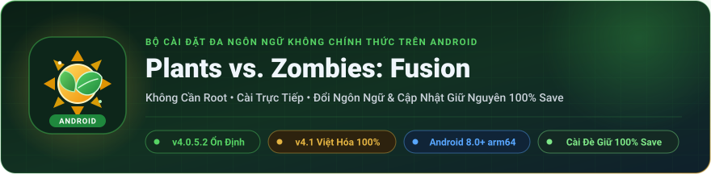

  
  
  
  
  
  

  &nbsp;&nbsp;
  &nbsp;&nbsp;
  

  🌐 <b>Switch Language / 切换语言:</b> Click <b><a href="README.md">[EN] English</a></b> for English • 点击 <b><a href="README.cn.md">[CN] 简体中文</a></b> 查看中文说明 • Link tự nhận diện ngôn ngữ: <a href="https://heagon.github.io/pvz-fusion-english-android/">Smart Link</a>

  <a href="#downloads"><b>📥 Tải Game</b></a> &nbsp;•&nbsp;
  <a href="#install"><b>🔄 Cài Đặt &amp; Đổi Ngôn Ngữ</b></a> &nbsp;•&nbsp;
  <a href="#highlights"><b>✨ Điểm Nổi Bật</b></a> &nbsp;•&nbsp;
  <a href="#screenshots"><b>📸 Ảnh Thực Tế</b></a> &nbsp;•&nbsp;
  <a href="#guides"><b>📚 Hướng Dẫn &amp; Sửa Lỗi</b></a> &nbsp;•&nbsp;
  <a href="#credits"><b>👥 Đội Ngũ (Credits)</b></a>

---

## 📥 Tải Về Bộ Cài APK

> [!TIP]
> **Cam Kết Giữ Nguyên 100% Save Game:** Tất cả các bản APK trong kho này (**`[VI] Bản Việt Hóa`**, **`[EN] English`**, **`[CN] Trung Gốc`**) đều được ký bằng cùng một **Release Keystore chính thức**. Khi nâng cấp phiên bản mới hoặc đổi qua lại giữa các ngôn ngữ, bạn chỉ cần **bấm Cài đặt đè / Cập nhật (Update)** — **tuyệt đối không gỡ bản cũ** — toàn bộ cây đã mở khóa, tiền vàng và màn chơi sẽ được giữ nguyên vẹn!

### Nên Chọn Phiên Bản Nào?

| Phiên bản | Nhánh phát hành | Mức độ hoàn thiện | Khuyên dùng cho ai? |
| :--- | :--- | :--- | :--- |
| **v4.0.5.2** | 🟢 **Bản Chính Thức (Stable)** | **`[VI]`** 100% · **`[EN]`** 100% · **`[CN]`** Nguyên bản | **Khuyên dùng cho đa số người chơi.** Độ ổn định cao nhất, đã kiểm thử toàn diện mọi chế độ trên máy Android thật. |
| **v4.1 Preview** | 🟡 **Bản Trải Nghiệm Sớm** | **`[VI]`** **100% Hoàn Chỉnh** · **`[EN]`** Preview · **`[CN]`** Nguyên bản | Người chơi muốn trải nghiệm ngay **Du Lịch: Tiến Hóa (AutoChess)**, **Chăn Nuôi Hướng Dương (Tycoon)**, **Bút Thần Vẽ Cây**, **Bắn Súng** và đủ **742 cây**. |

---

### 🟢 v4.0.5.2 (`B.0.1`) — Bản Chính Thức Ổn Định *(Khuyên dùng)*
Chi tiết cập nhật & mã kiểm tra SHA-256: **[Trang Release `v4.0.5.2-B.0.1`](https://github.com/Heagon/pvz-fusion-english-android/releases/tag/v4.0.5.2-B.0.1)** · Lịch sử bản build &amp; tải bản cũ: **[`CHANGELOG.md`](CHANGELOG.md)**

| Phiên bản ngôn ngữ | Dung lượng | Tóm tắt nội dung | Tải trực tiếp |
| :--- | :---: | :--- | :---: |
| **`[VI]` Bản Việt Hóa** | `599.6 MB` | Việt hóa hoàn chỉnh 100% (720 cây, 235 zombie, 47 cơ chế, 48 ảnh giao diện Việt hóa, font tiếng Việt có dấu sắc nét) |  |
| **`[EN]` English** | `599.7 MB` | Bản Tiếng Anh hoàn chỉnh (dịch trọn vẹn Sổ Tay & giao diện, đã căn chỉnh khung chữ chuẩn cho màn hình điện thoại) |  |
| **`[CN]` 中文原版 (Trung Gốc)** | `591.1 MB` | Bản tiếng Trung gốc nguyên bản của tác giả **蓝飘飘fly**, đóng gói cùng chữ ký để chuyển đổi qua lại không mất save |  |

---

### 🟡 v4.1 Preview (`B.0.3` / `B.0.2`) — Chế Độ AutoChess Mới *(Bản Việt Hóa Đã Đạt 100%)*
Chi tiết cập nhật & mã kiểm tra SHA-256: **[Trang Release `v4.1-half-translate-B.0.3`](https://github.com/Heagon/pvz-fusion-english-android/releases/tag/v4.1-half-translate-B.0.3)** · **[`B.0.2` (`EN`)](https://github.com/Heagon/pvz-fusion-english-android/releases/tag/v4.1-half-translate-B.0.2)** · Lịch sử bản build: **[`CHANGELOG.md`](CHANGELOG.md)**

> [!NOTE]
> **Trạng thái bản v4.1:** Riêng **`[VI] Bản Việt Hóa v4.1` (`B.0.3`)** đã được dịch và rà soát **hoàn chỉnh 100%** (+3.837 chuỗi tiếng Việt mới, trọn vẹn 742 cây / 238 zombie / 48 cơ chế Sổ Tay, 176 Bùa Thám Hiểm, đầy đủ AutoChess / Tycoon / Bút Thần / Bắn Súng, 0 chuỗi tiếng Anh/Trung thừa, 48/48 ảnh giao diện Việt hóa và đã vá lỗi crash Android 13/Nubia). Bản `[EN] English` (`B.0.2`) hiện đã dịch xong toàn bộ giao diện chế độ mới và đang hoàn thiện nốt các mục Sổ Tay phụ.

| Phiên bản ngôn ngữ | Dung lượng | Tóm tắt nội dung | Tải trực tiếp |
| :--- | :---: | :--- | :---: |
| **`[VI]` Bản Việt Hóa (`B.0.3`)** | `629.0 MB` | Việt hóa trọn vẹn 100% PvZ Fusion 4.1 (Sổ Tay 742 cây, AutoChess, Lõi Hex, Tycoon, Bút Thần, Bắn Súng, 48/48 texture Việt hóa, đã vá crash Android 13/Nubia) |  |
| **`[EN]` English (`B.0.2`)** | `628.8 MB` | Bản Tiếng Anh 4.1 Preview (+994 chuỗi giao diện AutoChess/Tycoon/Bút Thần theo ngữ cảnh, 48/48 texture Tiếng Anh) |  |
| **`[CN]` 中文原版 (`B.0.1`)** | `620.2 MB` | Bản tiếng Trung 4.1 gốc của **蓝飘飘fly**, ký chung chữ ký số để cài đè giữ nguyên save |  |

---

## 🔄 Hướng Dẫn Cài Đặt &amp; Đổi Ngôn Ngữ Trong 3 Bước

1. **Tải file APK:** Chọn phiên bản và ngôn ngữ bạn muốn ở bảng trên (**Android 8.0+**, chip 64-bit `arm64-v8a`, trống tối thiểu ~1.5 GB bộ nhớ).
2. **Bấm Cài Đặt Đè (Update / Install):** Mở file APK vừa tải về và chọn **Cập nhật / Cài đặt** đè trực tiếp lên game đang có trên máy (**TUYỆT ĐỐI KHÔNG gỡ cài đặt** bản cũ).
3. **Vào chơi ngay:** Ngôn ngữ/phiên bản mới áp dụng tức thì, **100% dữ liệu cày cuốc, cây trồng, tiền vàng, Vườn Zen (`playerData.json`) được bảo toàn nguyên vẹn!**

> [!IMPORTANT]
> **Lần đầu chuyển từ bản APK nguồn khác sang kho này?** Nếu điện thoại báo *"Ứng dụng chưa được cài đặt (xung đột gói)"* do khác chữ ký số, hãy sao lưu tệp `/sdcard/Android/data/com.LanPiaoPiao.PlantsVsZombiesRH/files/playerData.json` ra ngoài **trước khi** gỡ bản cũ. Xem hướng dẫn từng bước tại **[Sao Lưu &amp; Chuyển Dữ Liệu Save (`docs/MIGRATION.md`)](docs/MIGRATION.md#vi-bản-việt-hóa)**.

### 📚 Thư Viện Hướng Dẫn &amp; Xử Lý Sự Cố

| Tài liệu chi tiết | Nội dung bên trong |
| :--- | :--- |
| 📖 **[Hướng Dẫn Cài Đặt &amp; Sửa Lỗi (`docs/INSTALL.md`)](docs/INSTALL.md#vi-bản-việt-hóa)** | Cấu hình yêu cầu, cách cấp quyền cài APK, xử lý cảnh báo Google Play Protect và mẹo sửa lỗi màn hình đen / hồi chiêu cây bất thường. |
| 🔄 **[Cập Nhật Không Mất Save (`docs/UPDATE.md`)](docs/UPDATE.md#vi-bản-việt-hóa)** | Quy tắc vàng khi nâng cấp phiên bản hoặc đổi ngôn ngữ và cơ chế tự làm mới dữ liệu `unity_app_guid`. |
| 📋 **[Lịch Sử Bản Build &amp; Sửa Lỗi (`CHANGELOG.md`)](CHANGELOG.md)** | Toàn bộ danh sách bản build `B.<major>.<minor>` tách riêng từng Release để dễ phân biệt mới/cũ, tra cứu lỗi đã vá và cài lùi giữ save. |
| 💾 **[Sao Lưu &amp; Chuyển File Save (`docs/MIGRATION.md`)](docs/MIGRATION.md#vi-bản-việt-hóa)** | Cách chép file `playerData.json` trực tiếp ngay trên điện thoại (`ZArchiver` / `MT Manager`) hoặc qua máy tính (`adb`), không cần Root. |
| 🛠️ **[Công Cụ Đóng Gói Tĩnh (`tools/README.md`)](tools/README.md)** | Mã nguồn mở các script Python (`UnityPy`, trình biên dịch lại `global-metadata.dat`, đóng gói APK) minh bạch hóa quy trình build. |
| 👥 **[Danh Sách Đội Ngũ Đầy Đủ (`CREDITS.md`)](CREDITS.md#vi-bản-việt-hóa)** | Tri ân chi tiết toàn bộ tác giả game gốc, nhóm dịch thuật quốc tế, nhóm Việt hóa, họa sĩ và các thư viện mã nguồn mở. |

---

## ✨ Điểm Nổi Bật Của Bản Việt Hóa Android

Đây là bộ cài đặt đa ngôn ngữ không chính thức dành cho **Plants vs. Zombies: Fusion (植物大战僵尸融合版)** trên Android, sử dụng kỹ thuật **đóng gói tĩnh (static patching)** trực tiếp vào tệp tài nguyên gốc của game:

- **Cài Đặt 1 Chạm — Không Rườm Rà:** Chạy thẳng trên mọi máy Android phổ thông — **không cần Root, không cần máy tính, không cần cài thêm Mod Loader hay chép file OBB thủ công**.
- **Hiển Thị Tiếng Việt Có Dấu 100% Sắc Nét:** Tích hợp trực tiếp font dự phòng `LiberationSans` vào `data.unity3d`, hiển thị trọn vẹn mọi tổ hợp dấu phức tạp (`ừ, ỡ, ệ, ằ, ắ, ẫ, ậ...`), triệt tiêu hoàn toàn lỗi mất chữ hoặc ô vuông `[]`.
- **Dịch Thuật Trọn Vẹn Trực Tiếp Từ Bản Gốc:**
  - **Sổ Tay Bách Khoa:** Đầy đủ **720/720 thực vật, 235/235 zombie, 47/47 cơ chế** (bản `v4.0.5.2-B.0.1`) và **742/742 thực vật, 238/238 zombie, 48/48 cơ chế** (bản `v4.1`).
  - **Toàn Bộ Chế Độ Chơi:** Phiêu Lưu, Sinh Tồn, Thử Thách, Giải Đố, Vườn Thư Thả, Huyền Bí, Bùa Thám Hiểm (Travel Buffs), cùng trọn bộ chế độ mới 4.1 (*Du Lịch: Tiến Hóa AutoChess*, *Chăn Nuôi Hướng Dương*, *Bút Thần Vẽ Cây*, *Bắn Súng*).
- **Việt Hóa Đồ Họa &amp; Căn Chỉnh Giao Diện Mobile:** Thay thế đầy đủ **48/48 kết cấu hình ảnh giao diện** (bảng gỗ, nút chọn chế độ, thanh tiến độ đợt zombie...) và cân chỉnh kích thước chữ chống tràn viền trên màn hình điện thoại thực tế.

---

## 📸 Hình Ảnh Thực Tế Trên Điện Thoại Android

Ảnh chụp trực tiếp trên thiết bị Android thật sau khi hoàn tất kiểm thử giao diện Bản Việt Hóa:

| Menu Chính (`v4.0.5.2-B.0.1`) | Sổ Tay Thực Vật (`v4.0.5.2-B.0.1`) |
| :---: | :---: |
| 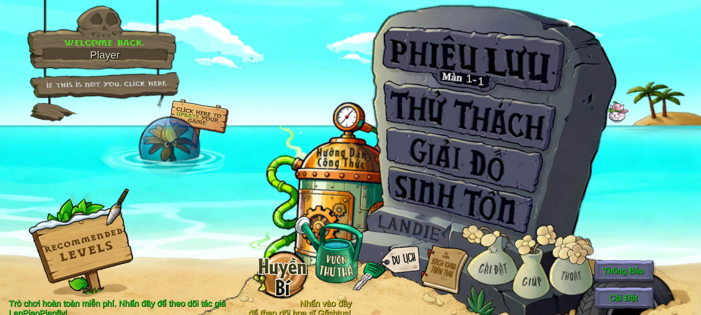 | 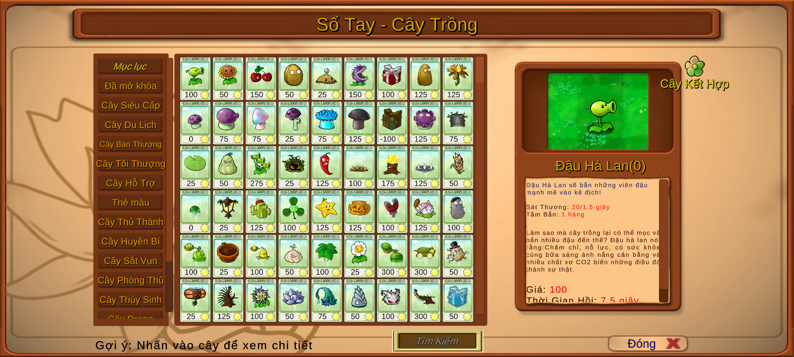 |
| **Vườn Thư Thả (`v4.0.5.2-B.0.1`)** | **Chiến Đấu &amp; Tạm Dừng (`v4.0.5.2-B.0.1`)** |
| 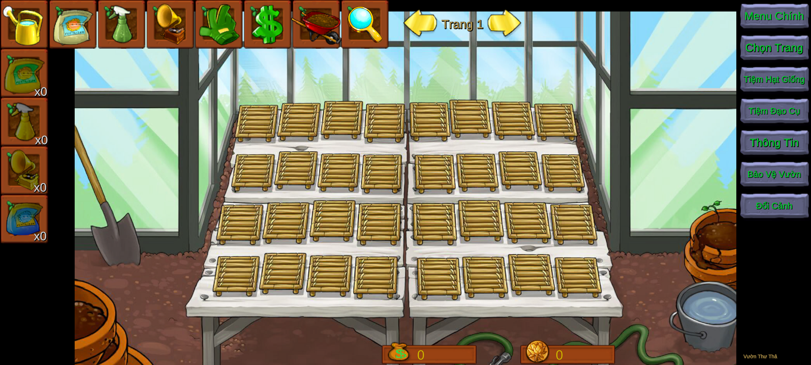 | 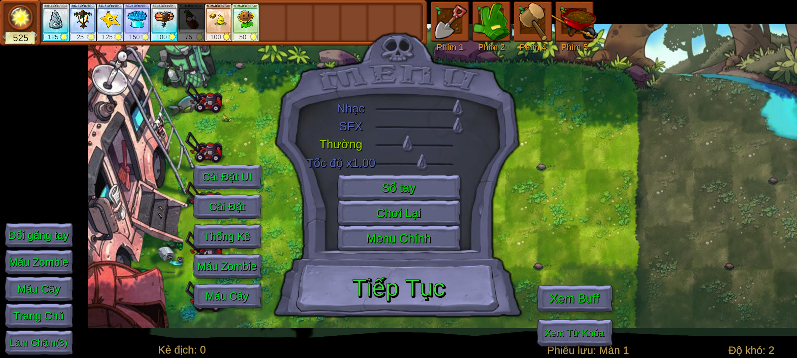 |

<b>🖼️ Xem thêm toàn bộ các chế độ chơi v4.0.5.2 (12 ảnh giao diện chi tiết)</b>

 

| Chế độ chơi | Chế độ chơi |
| :---: | :---: |
| **Cài Đặt** 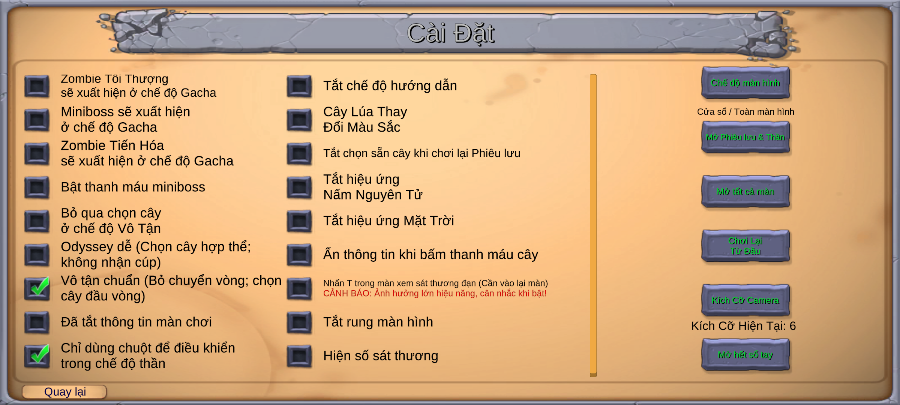 | **Chế Độ Sinh Tồn** 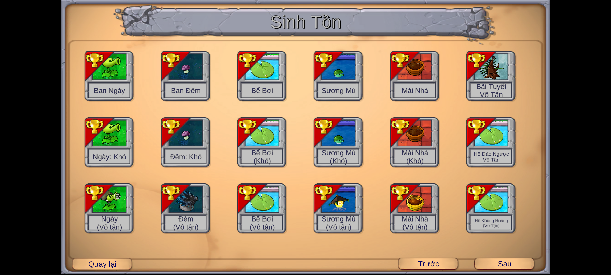 |
| **Chế Độ Thử Thách** 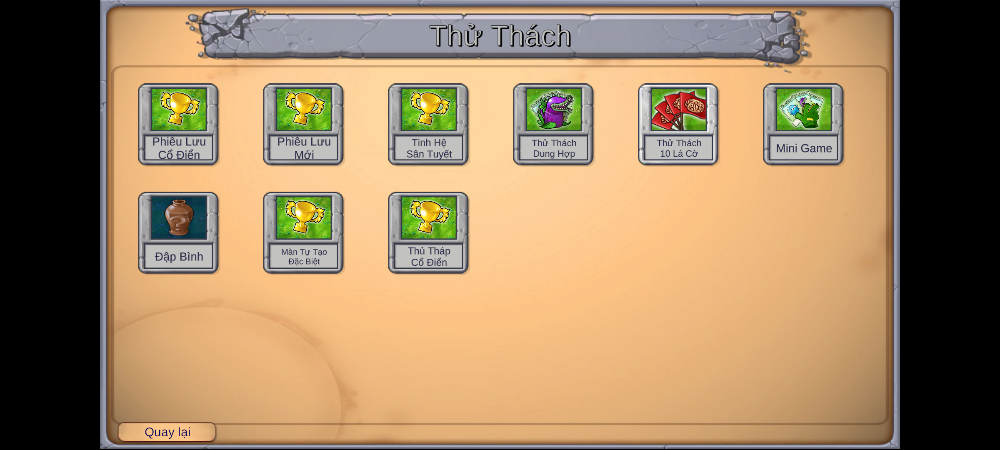 | **Chế Độ Giải Đố** 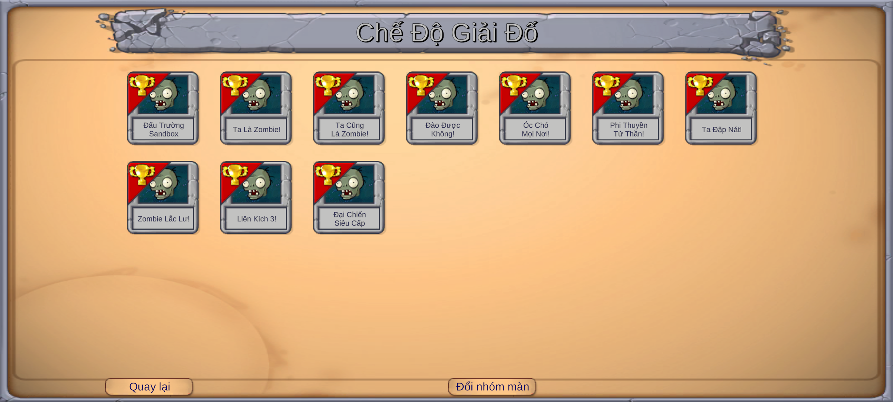 |
| **Màn Gợi Ý** 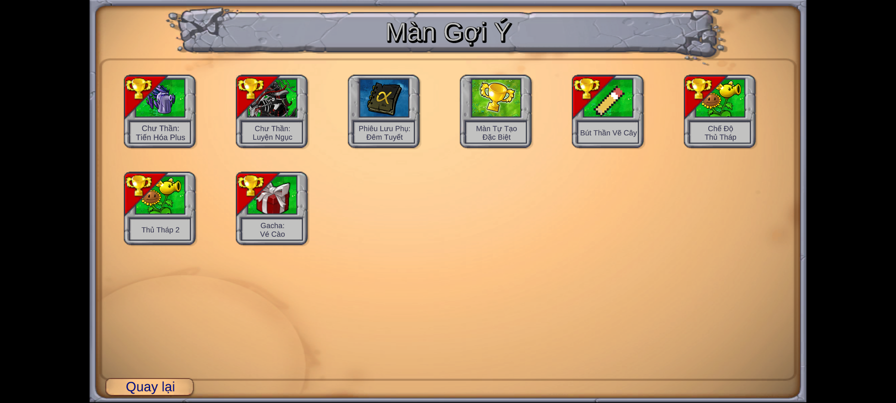 | **Sổ Tay Zombie** 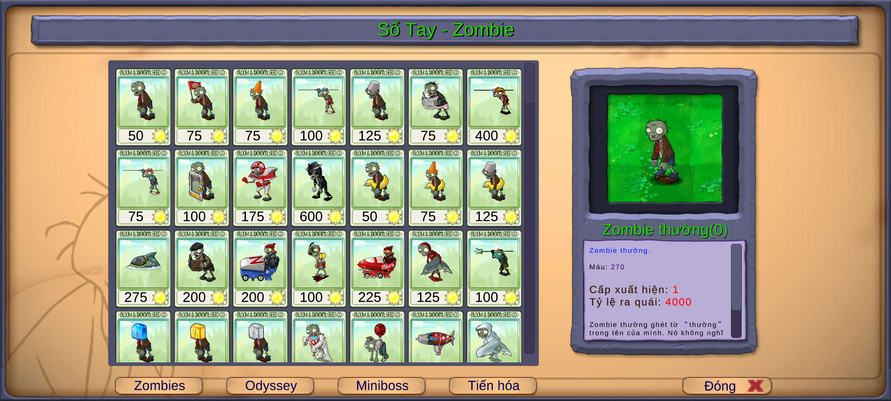 |
| **Sổ Tay Cơ Chế** 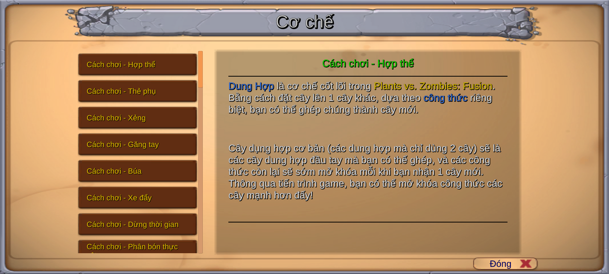 | **Từ Khóa / Bùa Thám Hiểm** 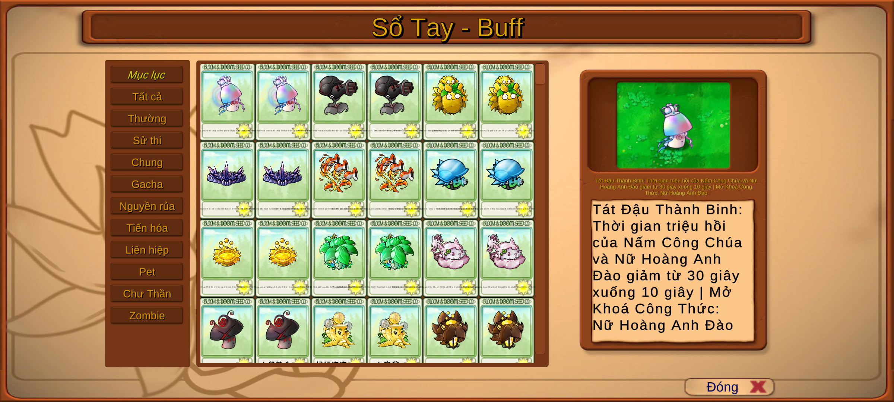 |
| **Du Lịch: Thử Thách** 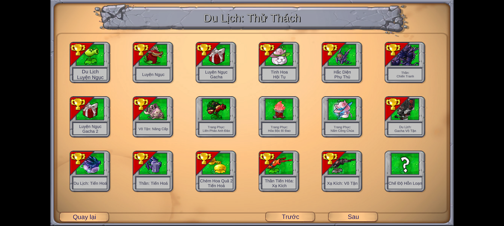 | **Chế Độ Huyền Bí** 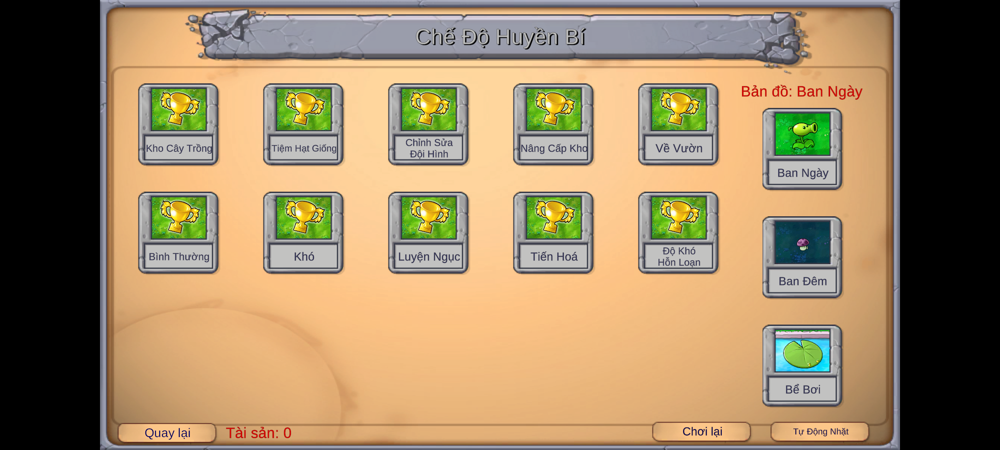 |
| **Chọn Hạt Giống Ra Trận** 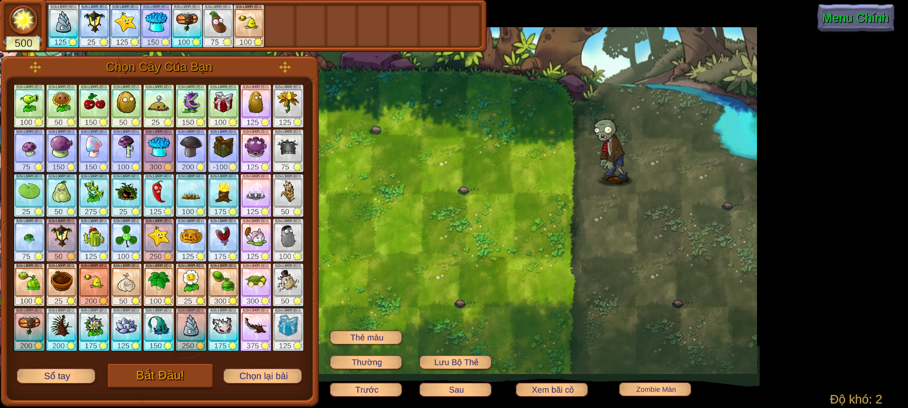 | **Giao Diện Trong Trận Đấu** 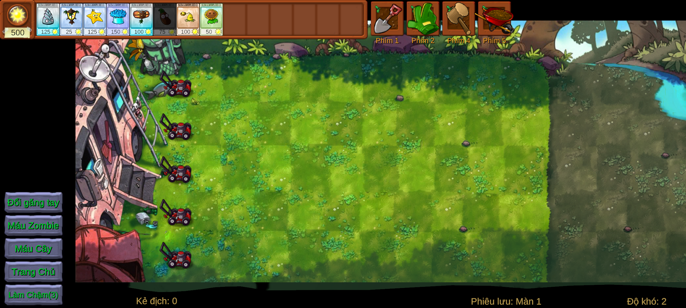 |

<b>🧪 Xem ảnh chụp thực tế bản v4.1 (AutoChess Tiến Hóa, Xem Trước Thủ Lĩnh &amp; Cửa Hàng)</b>

 

| Giao diện mới bản v4.1 | Giao diện mới bản v4.1 |
| :---: | :---: |
| **Màn Gợi Ý (`v4.1`)** 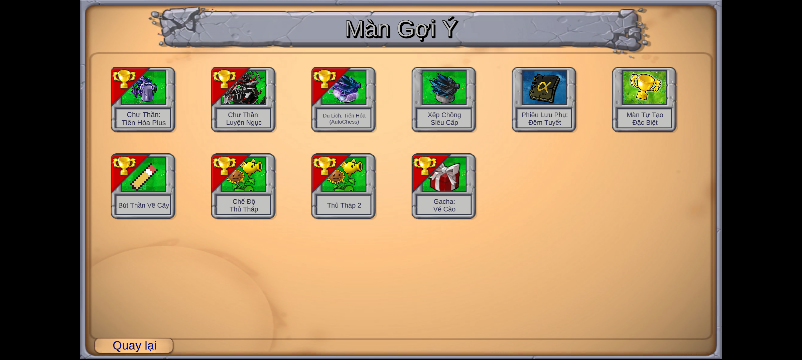 | **Chọn Hồ Sơ Save (`v4.1`)** 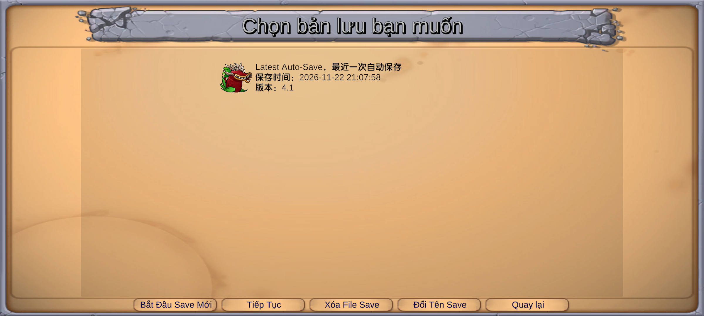 |
| **Chọn Độ Khó AutoChess** 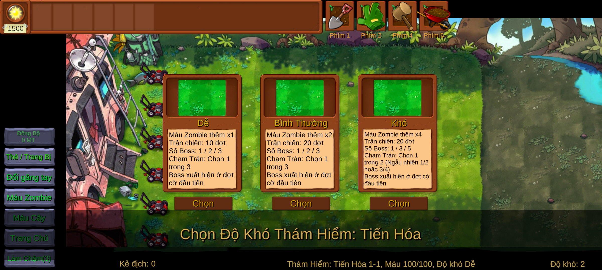 | **Xem Trước Thủ Lĩnh (Boss Preview)** 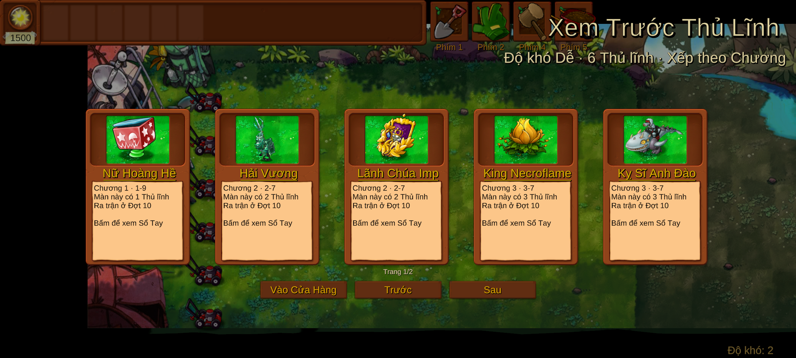 |
| **Cửa Hàng Giữa Vòng (Intermission Shop)** 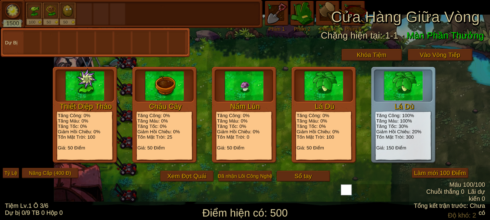 | **Menu Chính (`v4.1`)** 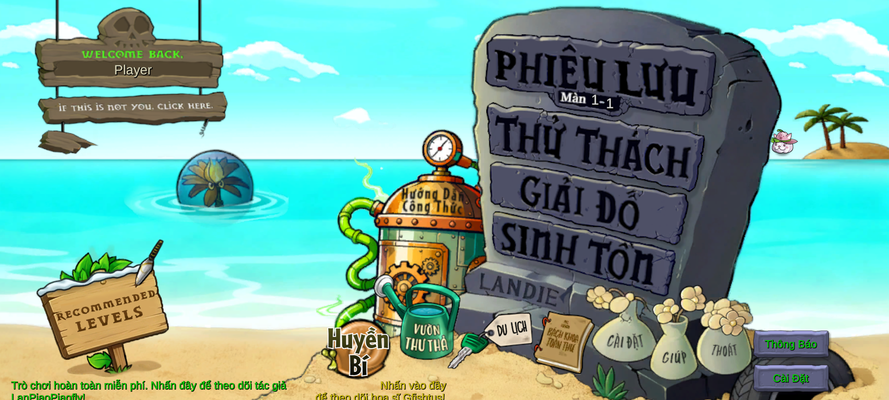 |

---

## 👥 Đội Ngũ Thực Hiện &amp; Tri Ân (Credits)

Bộ cài đặt Android này được hoàn thiện dựa trên tâm huyết của đội ngũ phát triển gốc và cộng đồng dịch thuật. Xem hồ sơ vinh danh chi tiết tại **[CREDITS.md](CREDITS.md#vi-bản-việt-hóa)**.

| Hạng mục / Vai trò | Tác giả &amp; Thành viên đóng góp | Liên kết chính thức &amp; Giấy phép |
| :--- | :--- | :--- |
| **Tác giả Trò Chơi Gốc** *Plants vs. Zombies: Fusion* (植物大战僵尸融合版) | • **LanPiaoPiaofly (蓝飘飘fly)** — Tác giả, Nhà sản xuất, Thiết kế game, Lập trình chính, Hoạt ảnh &amp; Đạo diễn hình ảnh • **Gfishtus / JiYuTuSi (机鱼吐司 / 机鱼)** — Đồng thiết kế, Họa sĩ chính &amp; Hoạt ảnh • **LanDie (蓝蝶)** — Hỗ trợ hoạt ảnh &amp; Mỹ thuật • **MengLuo (梦珞)** — Sản xuất &amp; Dựng video • **Lời cảm ơn đặc biệt từ đội ngũ gốc:** 北窗遥望, 略nd, MC-大麦, 潜艇伟伟迷, 熔莹, 射命丸文, 使徒, Tip杨山木雁, 小黄鸡, 云耀yoke, 庄不纯 | [Bilibili Chính Thức](https://space.bilibili.com/3546619314178489) |
| **Bản Việt Hóa** *(Cộng đồng Việt Nam)* | • **Team CBD &amp; Team Bloom** — Đội ngũ phát triển Bản Việt Hóa cộng đồng PvZ Fusion Việt Nam • **Nhóm Việt Hóa trên PVZF-Translation:** Shion, Cryda, JustNull • **Hoàn thiện Việt Hóa Android v4.0.5.2 &amp; v4.1 (100%):** Heagon (dịch bổ sung +3.837 chuỗi 4.1 mới, Việt hóa trọn bộ 48/48 ảnh giao diện &amp; tích hợp font tiếng Việt có dấu `LiberationSans`) | [PVZF-Translation](https://github.com/Teyliu/PVZF-Translation) |
| **Nền Tảng Đa Ngôn Ngữ &amp; Kỹ Thuật Mod** (*PVZF-Translation*) | • **Mamoru-kun** — Biên dịch viên Tiếng Anh chính • **NaKune** — Tác giả bản Mod dịch thuật đầu tiên • **Climeron** — Hỗ trợ lập trình &amp; Hệ thống đổi font chữ • **Teyliu, Cassidy, JustNull, Dakosha** — Lập trình &amp; duy trì Mod dịch thuật • **TrevTV** — Hệ thống âm thanh [MelonLoader-AudioTools](https://github.com/TrevTV/MelonLoader-AudioTools) • **Rollerlhite** — [Nhạc nền Menu chính mới](https://www.youtube.com/watch?v=aBj1MfvnHPE) • **Cassidy** — Thiết kế Logo *PvZ: Fusion* Tiếng Anh • **Roaoming, Shel, flexyj, CarrotD1scord, Xabdi** — Việt hóa/Chuyển ngữ Texture giao diện &amp; Nhạc trong trận • **Blooms / The Blooms Community** — Đóng gói bản PC đa ngôn ngữ &amp; Hỗ trợ ý tưởng dịch thuật | [PVZF-Translation](https://github.com/Teyliu/PVZF-Translation) · [Mã nguồn Mod DLL](https://github.com/Teyliu/PVZFusionTranslation) · [Discord](https://discord.gg/DPAC5ZVJ8T) · [Sổ Tay Online](https://carroti4ch.itch.io/almanac) Giấy phép: **[CC BY-NC 4.0](https://creativecommons.org/licenses/by-nc/4.0/)** |
| **Đội Ngũ Dịch &amp; Hiệu Đính Tiếng Anh** | • **Biên dịch:** Mamoru-kun, Cassidy, Ungoodapple, JustTer, Invis19 • **Hiệu đính:** TheXL, QwwYQ, Bertie690, revo • **Cựu thành viên đóng góp:** Dyna, Professor Cherry Zaitsev, Dimardan, IzzytehWolf, <code>&#124;&gt;.&lt;&#124;</code>, Diiax, Hetsuko, Metroidsans, Flow | [PVZF-Translation](https://github.com/Teyliu/PVZF-Translation) |
| **Đóng Gói Android, Tối Ưu UI &amp; Tự Động Hóa** | • **Heagon** — Xây dựng quy trình đóng gói tĩnh Unity bundle &amp; biên dịch lại IL2CPP metadata, tối ưu khung chữ mobile, cơ chế `unity_app_guid` giữ save và ký đồng bộ Release Keystore • **Ghi nhận các bản port Android cộng đồng tiền nhiệm:** silvershadow ([pvzf-android-translation](https://github.com/silvershadowkat/pvzf-android-translation)), Joseph Franci • **Công cụ mã nguồn mở sử dụng:** [UnityPy](https://github.com/K0lb3/UnityPy), [fontTools](https://github.com/fonttools/fonttools), [Pillow](https://python-pillow.org/), [Liberation Fonts](https://github.com/liberationfonts/liberation-fonts), [uber-apk-signer](https://github.com/patrickfav/uber-apk-signer) | [Kho GitHub Dự Án](https://github.com/Heagon/pvz-fusion-english-android) |

---

## ⚖️ Bản Quyền &amp; Tuyên Bố Miễn Trừ Trách Nhiệm

- **Thương hiệu gốc:** *Plants vs. Zombies* là nhãn hiệu đã đăng ký thuộc bản quyền của **Electronic Arts Inc. (EA) / PopCap Games**.
- **Giấy phép tài nguyên dịch thuật:** Dữ liệu dịch thuật cộng đồng từ dự án [PVZF-Translation](https://github.com/Teyliu/PVZF-Translation) được phân phối theo giấy phép **[Creative Commons Attribution-NonCommercial 4.0 International (CC BY-NC 4.0)](https://creativecommons.org/licenses/by-nc/4.0/)** — nghiêm cấm mọi hành vi sao chép thương mại, bán bản cài đặt hoặc chèn quảng cáo thu lợi.
- **Dự án phi lợi nhuận của người hâm mộ:** Kho lưu trữ này là dự án bản địa hóa **hoàn toàn miễn phí, phi thương mại, không quảng cáo**, phục vụ cộng đồng người chơi Android. Mọi quyền đối với bản fangame gốc thuộc về tác giả **蓝飘飘fly** và đội ngũ sản xuất.
