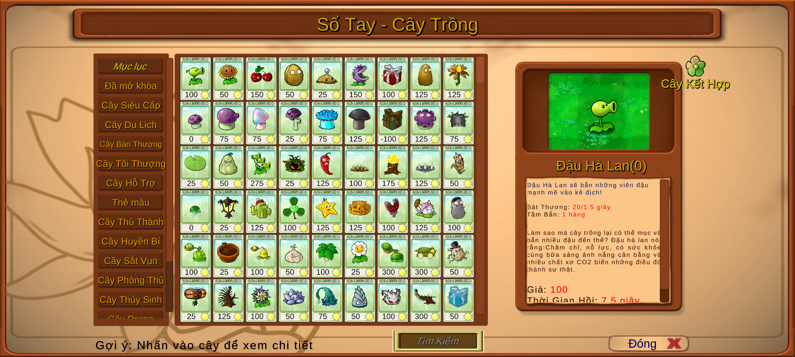
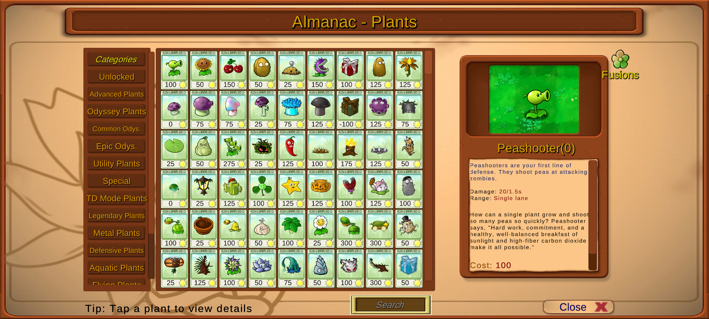
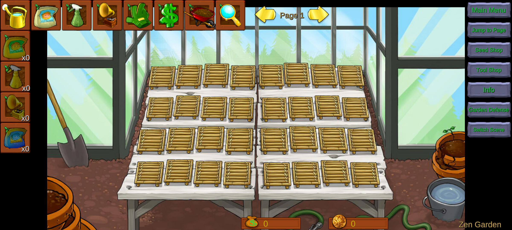
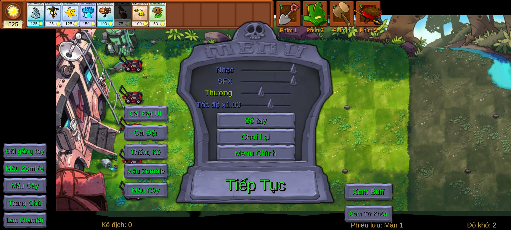

# Plants vs. Zombies: Fusion (Android) v4.0.5.2 — Multi-Language Suite
### 植物大战僵尸融合版 安卓全语言整合包 · Bộ Cài Đặt Đa Ngôn Ngữ PvZ Fusion Android

<p align="center">
  <a href="#vi-hướng-dẫn--chi-tiết-bản-việt-hóa"><b>[VI] Bản Việt Hóa</b></a> •
  <a href="#en-guide--english-build-details"><b>[EN] English</b></a> •
  <a href="#cn-使用指南与版本详情"><b>[CN] 简体中文</b></a>
</p>

---

## 📥 Tải Về / Downloads / 下载专区

Tất cả các bản APK đều được ký bằng cùng một **Release Keystore chính thức**, đảm bảo **không bao giờ bị mất dữ liệu chơi (save game)** khi bạn cập nhật hoặc chuyển đổi qua lại giữa các ngôn ngữ.

All APK builds are signed with the project's official **Release Keystore**, ensuring **safe in-place updates with 100% save preservation** across languages.

所有 APK 均使用统一的**官方发布签名证书**，支持直接覆盖安装，**跨语言切换与版本更新绝不丢失存档**。

### 📊 Bảng tải xuống / Download Table / 下载列表

| Ngôn ngữ / Language / 语言 | Tệp APK / File / 安装包 | Dung lượng / Size | Mô tả / Description / 说明 |
| :--- | :--- | :--- | :--- |
| **[VI] Bản Việt Hóa** | [PvZ-Fusion-4.0.5.2-Vietnamese.apk](https://github.com/Heagon/pvz-fusion-english-android/releases/download/v4.0.5.2/PvZ-Fusion-4.0.5.2-Vietnamese.apk) | 599.6 MB | Bản Việt Hóa hoàn chỉnh (dịch chuẩn từ tiếng Trung, font tiếng Việt 100% không lỗi ký tự) |
| **[EN] English** | [PvZ-Fusion-4.0.5.2-English.apk](https://github.com/Heagon/pvz-fusion-english-android/releases/download/v4.0.5.2/PvZ-Fusion-4.0.5.2-English.apk) | 599.7 MB | Complete English build (translated from Chinese, optimized mobile uGUI typography) |
| **[CN] 中文原版** | [PvZ-Fusion-4.0.5.2-Chinese-Raw.apk](https://github.com/Heagon/pvz-fusion-english-android/releases/download/v4.0.5.2/PvZ-Fusion-4.0.5.2-Chinese-Raw.apk) | 591.1 MB | 蓝飘飘fly 原版中文（官方签名，可与各语言版相互覆盖不丢存档） |

---

<a id="vi-hướng-dẫn--chi-tiết-bản-việt-hóa"></a>
## [VI] Hướng Dẫn & Chi Tiết Bản Việt Hóa

### 🔄 Cách đổi ngôn ngữ không mất Save
1. **Tải file APK:** Chọn ngôn ngữ bạn muốn chơi ở bảng phía trên rồi tải về máy.
2. **Cài đè (Install / Update):** Mở file APK vừa tải và bấm **Cập nhật (Install / Update)** đè trực tiếp lên game đang có trên máy (**tuyệt đối không gỡ cài đặt** game cũ).
3. **Mở lại game:** Ngôn ngữ mới sẽ được áp dụng ngay lập tức, và **toàn bộ dữ liệu cày cuốc, cây cối, tiền vàng, màn chơi (`playerData.json`) được giữ nguyên vẹn 100%!**

### ✨ Điểm nổi bật
- **Hỗ trợ 100% tiếng Việt có dấu:** Hệ thống tích hợp font `LiberationSans` trong asset bundle `data.unity3d`, giúp toàn bộ các ký tự có dấu (`ừ, ỡ, ệ, ằ, ú, ắ, â, ĩ, ô, ễ...`) hiển thị sắc nét, không bị lỗi mất ký tự hay ô vuông `[]`.
- **Dịch trọn vẹn nội dung:** Đầy đủ 720 cây trồng, 235 zombie, 47 cơ chế Bách khoa toàn thư (Almanac), giao diện menu, HUD chiến đấu và hệ thống bùa Thám hiểm (Travel Buffs).
- **Tối ưu UI/UX trên thiết bị thực tế:** Đã kiểm thử thực tế trên Android qua toàn bộ chế độ chơi (Phiêu Lưu, Sinh Tồn, Thử Thách, Giải Đố, Du Lịch, Huyền Bí, Vườn Zen, Sổ Tay, Trận Đấu), cân chỉnh kích thước chữ chống tràn viền và việt hóa 48 kết cấu hình ảnh (bao gồm thanh tiến độ màn chơi).

---

<a id="en-guide--english-build-details"></a>
## [EN] Guide & English Build Details

### 🔄 In-Place Update & Language Switching (Preserve All Saves)
1. **Download APK:** Select your desired language from the download table above.
2. **Install Over (Update):** Open the downloaded APK and tap **Update / Install** directly over your existing game (**do NOT uninstall** the previous version).
3. **Launch the Game:** The new language will take effect immediately, and **100% of your progress, unlocked plants, coins, and levels (`playerData.json`) are completely preserved!**

### ✨ Highlights
- **Comprehensive translation:** Covers the Almanac (720 plants, 235 zombies, 47 mechanics), main menus, stage selection, difficulty settings, Odyssey buffs, HUD, and in-game dialogues.
- **Font & layout optimization:** Implements optimized uGUI typography to ensure crisp rendering and zero text cut-offs on mobile screens.
- **Official keystore signing:** Dynamically updates `unity_app_guid` to ensure Unity IL2CPP metadata automatically reloads without clearing user storage.

---

<a id="cn-使用指南与版本详情"></a>
## [CN] 使用指南与版本详情

### 🔄 覆盖安装与语言无损切换指南（保留全部存档）
1. **下载 APK 安装包：** 从上方的下载表格中选择所需语言版本的安装包并下载到手机中。
2. **直接覆盖安装：** 打开下载好的 APK 安装包，直接点击**更新 / 安装**覆盖当前设备上的游戏版本（**切勿卸载旧版本**）。
3. **重新打开游戏：** 新语言即刻生效，**所有的关卡进度、已解锁植物、金币及存档文件（`playerData.json`）均 100% 完整保留！**

### ✨ 版本特性
- **[CN] 中文原版：** 完整保留作者蓝飘飘fly的原版代码、纹理与数值，采用相同签名打包，便于随时切回原版体验。
- **[VI] Bản Việt Hóa：** 基于原版深度翻译，完美支持全部越南语重音字符，界面排版精心调优，消除文字溢出。
- **[EN] English：** 完整移植英文本地化成果，优化手机端排版，全英文界面与图鉴。

---

## 📸 Hình Ảnh Thực Tế / Screenshots / 实机游戏截图

| [VI] Bản Việt Hóa | [EN] English |
| :---: | :---: |
|  |  |
|  |  |
|  |  |
|  |  |

---

## 👥 Credits &amp; Documentation / Đội Ngũ &amp; Tài Liệu / 致谢与文档

- **Pages / Trang ngôn ngữ / 语言主页:** [**`[VI]` Bản Việt Hóa**](https://github.com/Heagon/pvz-fusion-english-android/blob/main/README.vi.md) · [**`[EN]` English**](https://github.com/Heagon/pvz-fusion-english-android#readme) · [**`[CN]` 简体中文**](https://github.com/Heagon/pvz-fusion-english-android/blob/main/README.cn.md) · [**Full Credits (`CREDITS.md`)**](https://github.com/Heagon/pvz-fusion-english-android/blob/main/CREDITS.md)
- **Original Game (*PvZ: Fusion*):** **LanPiaoPiaofly (蓝飘飘fly)**, **Gfishtus (机鱼吐司)**, **LanDie (蓝蝶)**, **MengLuo (梦珞)** &amp; team ([Bilibili](https://space.bilibili.com/3546619314178489))
- **Multi-Language Mod &amp; English Localization:** **[PVZF-Translation](https://github.com/Teyliu/PVZF-Translation)** (`Mamoru-kun`, `NaKune`, `Climeron`, `Teyliu`, `Cassidy`, `JustNull`, `Dakosha`, `TrevTV`, `Rollerlhite`, `Roaoming`, `Shel`, `flexyj`, `CarrotD1scord`, `Xabdi`, `The Blooms Community` — [CC BY-NC 4.0](https://creativecommons.org/licenses/by-nc/4.0/))
- **Vietnamese Localization (`Bản Việt Hóa`):** **Team CBD &amp; Team Bloom** · `Shion`, `Cryda`, `JustNull`
- **Android Porting &amp; Save-Safe Suite:** **Heagon** ([pvz-fusion-english-android](https://github.com/Heagon/pvz-fusion-english-android))

---

<details>
<summary><b>🔍 Technical Checksums / Mã kiểm tra SHA-256 / 校验码</b></summary>

```
PvZ-Fusion-4.0.5.2-Vietnamese.apk: 78f23a7265cbdffcab5d888958efb995c42f4a91f18e86f91bea1f543204260b
PvZ-Fusion-4.0.5.2-English.apk:    f923f9abada8bdccab606f63fb3f78a9854cf0bb86fa06d68c3863629bc5a8c5
PvZ-Fusion-4.0.5.2-Chinese-Raw.apk: 51a084faf0eac1a8d633f7e4f0749441655a3d909df8befb71cc70d82fe0739a
```
</details>
