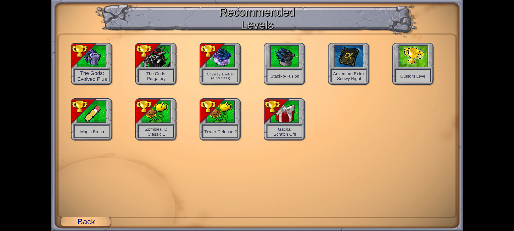
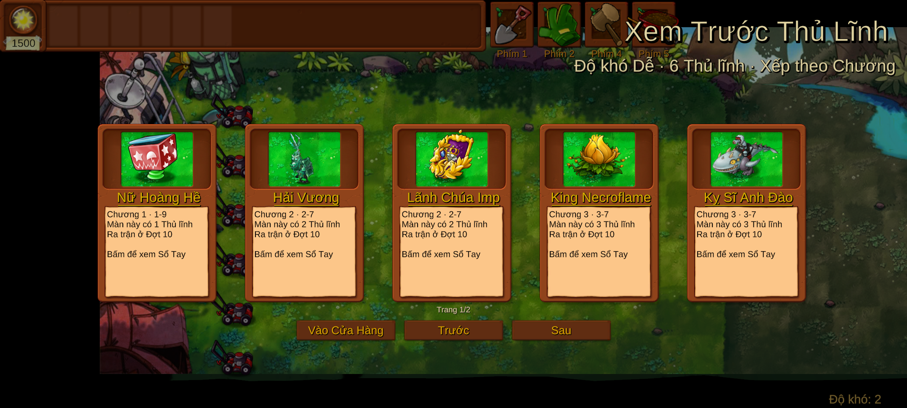
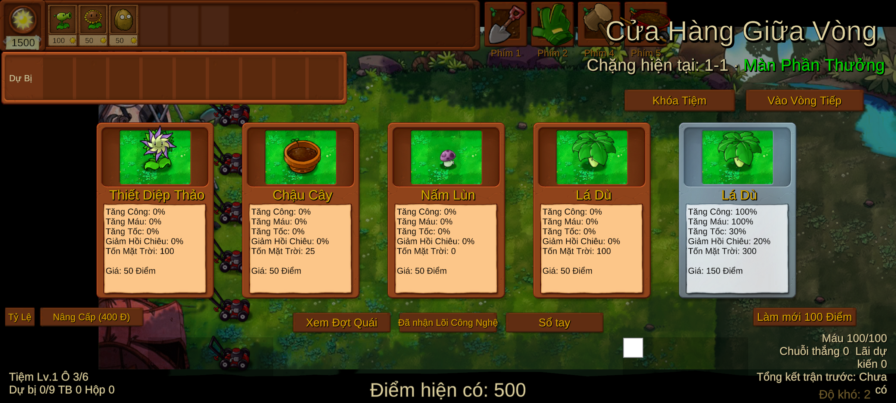

# Plants vs. Zombies: Fusion (Android) v4.1 Preview — Multi-Language Suite
### 植物大战僵尸融合版 4.1 尝鲜版 安卓全语言整合包 · Bộ Cài Đặt Đa Ngôn Ngữ PvZ Fusion Android 4.1 Preview

<p align="center">
  <a href="#vi-hướng-dẫn--nội-dung-bản-41"><b>[VI] Bản Việt Hóa</b></a> •
  <a href="#en-guide--41-preview-details"><b>[EN] English</b></a> •
  <a href="#cn-使用指南与-41-版本详情"><b>[CN] 简体中文</b></a>
</p>

---

> [!WARNING]
> **Half-Translate / Bản thử nghiệm sớm / 尝鲜体验版:**
> - **[VI]:** Phiên bản **Việt Hóa hoàn chỉnh 100%** cho PvZ Fusion 4.1 (bao gồm Du Lịch: Tiến Hóa AutoChess, Chăn Nuôi Hướng Dương / Tycoon, Bút Thần Vẽ Cây, Chế Độ Bắn Súng, toàn bộ 742 cây / 238 zombie / 48 cơ chế Sổ Tay, toàn bộ 176 Bùa Thám Hiểm mới, 0 chuỗi rơi về tiếng Anh, 0 chuỗi UI tiếng Trung, và Việt hóa hoàn toàn 7 ảnh bảng gỗ/sóng lớn).
> - **[EN]:** Early preview build for PvZ Fusion 4.1 (Odyssey: Evolved AutoChess, Sunflower Breeding / Tycoon, Magic Brush, new Odyssey plants). All new 4.1 modes, menus, and AutoChess Shop UI have been contextually translated and verified on a real Android device; minor edge strings continue to be refined.
> - **[CN]:** 4.1 版本的尝鲜体验包（包含自走棋远征进化、向日葵养殖、神笔马良与新植物）。已针对 4.1 新增界面与自走棋商店完成语境翻译并经过安卓真机校验，部分冷门文本仍在持续完善中。

---

## 📥 Tải Về / Downloads / 下载专区

Tất cả các bản APK đều được ký bằng cùng một **Release Keystore chính thức**, đảm bảo **không bao giờ bị mất dữ liệu chơi (save game)** khi bạn cập nhật hoặc chuyển đổi qua lại giữa các ngôn ngữ.

All APK builds are signed with the project's official **Release Keystore**, ensuring **safe in-place updates with 100% save preservation** across languages.

所有 APK 均使用统一的**官方发布签名证书**，支持直接覆盖安装，**跨语言切换与版本更新绝不丢失存档**。

### 📊 Bảng tải xuống / Download Table / 下载列表

| Ngôn ngữ / Language / 语言 | Tệp APK / File / 安装包 | Dung lượng / Size | Mô tả / Description / 说明 |
| :--- | :--- | :--- | :--- |
| **[VI] Bản Việt Hóa** | [PvZ-Fusion-4.1-Vietnamese-HalfTranslate.apk](https://github.com/Heagon/pvz-fusion-english-android/releases/download/v4.1-half-translate/PvZ-Fusion-4.1-Vietnamese-HalfTranslate.apk) | 629.0 MB | Bản Việt Hóa 4.1 hoàn chỉnh 100% (dịch trọn vẹn Sổ Tay, Bùa Thám Hiểm, AutoChess/Tycoon/Bút Thần/Bắn Súng, 0 tiếng Anh/Trung thừa, Việt hóa 48/48 texture, đã vá lỗi crash mở game trên Android 13/Nubia) |
| **[EN] English** | [PvZ-Fusion-4.1-English-HalfTranslate.apk](https://github.com/Heagon/pvz-fusion-english-android/releases/download/v4.1-half-translate/PvZ-Fusion-4.1-English-HalfTranslate.apk) | 628.8 MB | English 4.1 Preview build (Half-Translate, contextual AutoChess/Tycoon/Magic Brush UI & layout verified on Android) |
| **[CN] 中文原版** | [PvZ-Fusion-4.1-Chinese-Raw.apk](https://github.com/Heagon/pvz-fusion-english-android/releases/download/v4.1-half-translate/PvZ-Fusion-4.1-Chinese-Raw.apk) | 620.2 MB | 蓝飘飘fly 原版 4.1 中文（官方签名，可与各语言版相互覆盖不丢存档） |

---

## 📸 Hình Ảnh Thực Tế v4.1 / Real-Device Screenshots / 4.1 真机截图

Ảnh chụp thực tế trên thiết bị Android sau khi rà soát hiển thị các màn chơi & giao diện mới của **v4.1 Preview** cho cả **[VI] Bản Việt Hóa** và **[EN] English**:

| [VI] Bản Việt Hóa | [EN] English |
| :---: | :---: |
| **Màn Gợi Ý v4.1 / Recommended Levels / 推荐关卡** | **Màn Gợi Ý v4.1 / Recommended Levels / 推荐关卡** |
|  |  |
| **Chọn Độ Khó AutoChess / AutoChess Difficulty / 远征进化难度** | **Chọn Độ Khó AutoChess / AutoChess Difficulty / 远征进化难度** |
|  |  |
| **Xem Trước Thủ Lĩnh / Boss Preview / 首领预览** | **Xem Trước Thủ Lĩnh / Boss Preview / 首领预览** |
|  |  |
| **Cửa Hàng Giữa Vòng / Intermission Shop / 回合商店** | **Cửa Hàng Giữa Vòng / Intermission Shop / 回合商店** |
|  |  |

---

<a id="vi-hướng-dẫn--nội-dung-bản-41"></a>
## [VI] Hướng Dẫn & Nội Dung Bản 4.1

### 🔄 Cách đổi ngôn ngữ không mất Save
1. **Tải file APK:** Chọn ngôn ngữ bạn muốn chơi ở bảng phía trên rồi tải về máy.
2. **Cài đè (Install / Update):** Mở file APK vừa tải và bấm **Cập nhật (Install / Update)** đè trực tiếp lên game đang có trên máy (**tuyệt đối không gỡ cài đặt** game cũ).
3. **Mở lại game:** Ngôn ngữ mới sẽ được áp dụng ngay lập tức, và **toàn bộ dữ liệu cày cuốc, cây cối, tiền vàng, màn chơi (`playerData.json`) được giữ nguyên vẹn 100%!**

### ✨ Nội dung cập nhật 4.1
- **Việt hóa hoàn chỉnh 100% toàn bộ PvZ Fusion 4.1 (+3.837 chuỗi tiếng Việt mới, 5.069 chuỗi hệ thống, 0 chuỗi rơi về tiếng Anh):**
  - **Du Lịch: Tiến Hóa (AutoChess):** Đầy đủ giao diện chọn độ khó, Xem Trước Thủ Lĩnh, Cửa Hàng Giữa Vòng, Tỷ lệ làm mới, hàng Dự Bị, nâng cấp cửa hàng, toàn bộ Lõi Công Nghệ (Hex), tổng kết vòng và bảng lệnh kiểm thử.
  - **Chăn Nuôi Hướng Dương (Tycoon), Bút Thần Vẽ Cây & Bắn Súng:** Đầy đủ cửa hàng, nghiên cứu đợt, phần thưởng khám phá, danh sách đen, kho cây, cứu trợ khẩn cấp, nhánh tiến hóa (`PlantEvolutionData`), cửa hàng Vườn (`Goods`), và toàn bộ Sổ Tay Bắn Súng (`ShootingAlmanacIndex`).
  - **Bùa Thám Hiểm & Mẹo Màn Chơi:** Dịch bổ sung 100% 176 Bùa Thám Hiểm (Travel Buffs) mới và toàn bộ 171 mẹo màn Thử Hợp Thể / CustomIZ.
  - **Sổ Tay 100% tiếng Việt:** Dịch hoàn thiện toàn bộ 114 thực vật và 35 zombie trước đây còn sót tiếng Anh — đạt **742/742 thực vật**, **238/238 zombie**, và **48/48 cơ chế** (0 chữ Trung, 0 chữ Anh thừa).
- **Đồ họa & Font chữ:** Thay thế đầy đủ **48/48 kết cấu hình ảnh giao diện** — bổ sung Việt hóa 7 ảnh trước đây còn tiếng Anh (`Màn Gợi Ý`, `Chào Mừng Trở Lại`, `Không Phải Bạn? Bấm Vào Đây`, `Bấm Vào Đây Cập Nhật Game Mới!`, `Thử Hợp Thể`, `Đợt Zombie Lớn Đang Tới!`) cùng font `LiberationSans` hiển thị tiếng Việt có dấu 100% sắc nét.
- **Sửa lỗi crash khi khởi động (27/11/2026):** Loại bỏ 9 khóa nhị phân chứa byte `NUL` trong bảng dịch gây hỏng cấu trúc `TalentNode` và tràn bộ cấp phát Unity (`SIGTRAP`) trên Android 13 (Nubia và các máy có allocator nghiêm ngặt), đồng thời gia cố bộ vá chuỗi/asset và bổ sung mô tả tiếng Việt chuẩn cho nhánh kỹ năng *Hút Máu*.

---

<a id="en-guide--41-preview-details"></a>
## [EN] Guide & 4.1 Preview Details

### 🔄 In-Place Update & Language Switching (Preserve All Saves)
1. **Download APK:** Select your desired language from the download table above.
2. **Install Over (Update):** Open the downloaded APK and tap **Update / Install** directly over your existing game (**do NOT uninstall** the previous version).
3. **Launch the Game:** The new language will take effect immediately, and **100% of your progress, unlocked plants, coins, and levels (`playerData.json`) are completely preserved!**

### ✨ Highlights
- **Contextual Translations for New 4.1 Modes (+994 English strings — complete UI coverage):**
  - **Odyssey: Evolved (AutoChess):** Full UI coverage for Difficulty Selection, Boss Preview, Intermission Shop, Shop Refresh Odds, Bench, Shop Upgrades, all Hex Augments, Odds, Round Settlement, and Test Console.
  - **Sunflower Breeding (Tycoon) & Magic Brush:** Complete menus, Wave Research, Exploration Rewards, Plant Blacklist, Plant Inventory, Emergency Aid, How to Play, and appraisal prompts.
  - **Almanac, Level Editor & Fixes:** Complete 4.1 Level Creator Help, Shooting Almanac Trials, Talent Nodes, Recipe 11 fix, and mobile pill/card layout adjustments.
- **Expanded Almanac:** 742 plants, 238 zombies, and 48 mechanics entries.
- **Textures & UI Polish:** All **48/48 UI textures** replaced (including `FlagMeterLevelProgress`) and verified on a real Android device.
- **Hotfix (2026-11-27, `[VI]` build):** Fixed an Android startup crash (`SIGTRAP` / Unity allocator overflow on Android 13 / Nubia devices) caused by 9 binary NUL-corrupted `TalentNode` translation keys and hardened the binary asset splicer.

---

<a id="cn-使用指南与-41-版本详情"></a>
## [CN] 使用指南与 4.1 版本详情

### 🔄 覆盖安装与语言无损切换指南（保留全部存档）
1. **下载 APK 安装包：** 从上方的下载表格中选择所需语言版本的安装包并下载到手机中。
2. **直接覆盖安装：** 打开下载好的 APK 安装包，直接点击**更新 / 安装**覆盖当前设备上的游戏版本（**切勿卸载旧版本**）。
3. **重新打开游戏：** 新语言即刻生效，**所有的关卡进度、已解锁植物、金币及存档文件（`playerData.json`）均 100% 完整保留！**

### ✨ 4.1 版本特性
- **[CN] 中文原版：** 完整保留作者蓝飘飘fly的原版代码、纹理与数值，采用相同签名打包，便于随时切回原版体验。
- **[VI] Bản Việt Hóa：** 已完成 4.1 全部文本 100% 越化（累计新增 3,837 条越化文本，补全 114 种植物与 35 种僵尸图鉴、176 条旅行词条、全部射击图鉴与关卡提示，移除全部英文回退，并完成 48 张全越化界面贴图；2026-11-27 热修复：移除导致 Android 13/Nubia 启动崩溃的 9 条 `TalentNode` 异常 NUL 键并加固打包器）。
- **[EN] English：** 新增 994 条 4.1 新模式英文语境翻译，完整替换 48 张界面贴图，全面覆盖自走棋商店/刷新概率/全海克斯、向日葵养殖、神笔马良、关卡编辑器帮助与存档界面。

---

## 👥 Credits &amp; Documentation / Đội Ngũ &amp; Tài Liệu / 致谢与文档

- **Pages / Trang ngôn ngữ / 语言主页:** [**`[VI]` Bản Việt Hóa**](https://github.com/Heagon/pvz-fusion-english-android/blob/main/README.vi.md) · [**`[EN]` English**](https://github.com/Heagon/pvz-fusion-english-android#readme) · [**`[CN]` 简体中文**](https://github.com/Heagon/pvz-fusion-english-android/blob/main/README.cn.md) · [**Full Credits (`CREDITS.md`)**](https://github.com/Heagon/pvz-fusion-english-android/blob/main/CREDITS.md)
- **Original Game (*PvZ: Fusion*):** **LanPiaoPiaofly (蓝飘飘fly)**, **Gfishtus (机鱼吐司)**, **LanDie (蓝蝶)**, **MengLuo (梦珞)** &amp; team ([Bilibili](https://space.bilibili.com/3546619314178489))
- **Multi-Language Mod &amp; English Localization:** **[PVZF-Translation](https://github.com/Teyliu/PVZF-Translation)** (`Mamoru-kun`, `NaKune`, `Climeron`, `Teyliu`, `Cassidy`, `JustNull`, `Dakosha`, `TrevTV`, `Rollerlhite`, `Roaoming`, `Shel`, `flexyj`, `CarrotD1scord`, `Xabdi`, `The Blooms Community` — [CC BY-NC 4.0](https://creativecommons.org/licenses/by-nc/4.0/))
- **Vietnamese Localization (`Bản Việt Hóa`):** **Team CBD &amp; Team Bloom** · `Shion`, `Cryda`, `JustNull` · v4.1 Android Completion: **Heagon**
- **Android Porting &amp; Save-Safe Suite:** **Heagon** ([pvz-fusion-english-android](https://github.com/Heagon/pvz-fusion-english-android))

---

<details>
<summary><b>🔍 Technical Checksums / Mã kiểm tra SHA-256 / 校验码</b></summary>

```
PvZ-Fusion-4.1-Vietnamese-HalfTranslate.apk: 81606687f29b864e7a01de6510ae036c3aed30a3871cc3c27bb81c10ee23a2cb
PvZ-Fusion-4.1-English-HalfTranslate.apk:    04b8de0ba0a45eca878f6eea6a4c7c2d6d92aeae58d737a2916ed95a72b359f9
PvZ-Fusion-4.1-Chinese-Raw.apk:              3144746c552455b88db28eedfa20777099ecdb9736ac679bbbe70cd4113cb5fd
```
</details>
