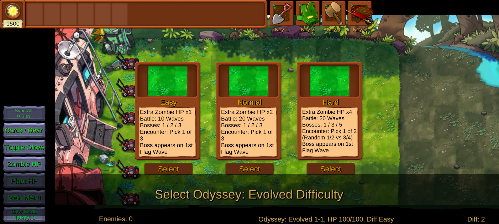
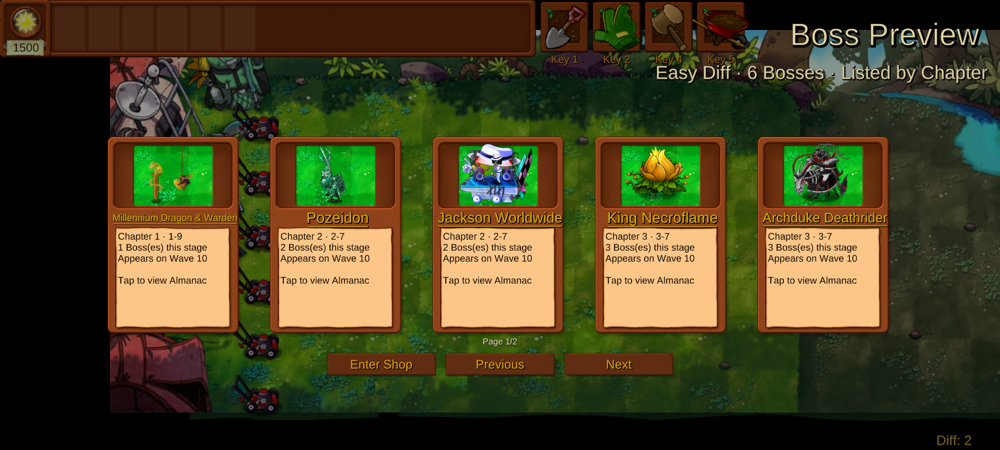
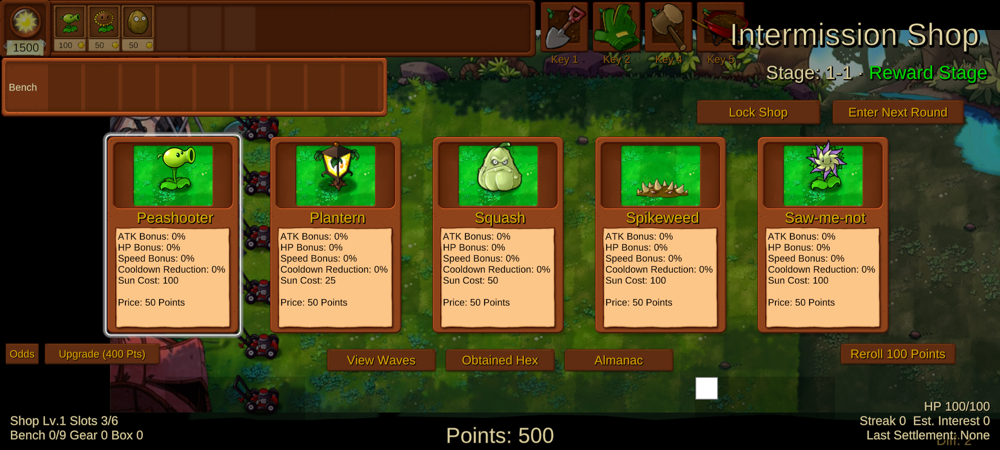

# Plants vs. Zombies: Fusion (Android) v4.1 Preview — Multi-Language Suite
### 植物大战僵尸融合版 4.1 尝鲜版 安卓全语言整合包 · Bộ Cài Đặt Đa Ngôn Ngữ PvZ Fusion Android 4.1 Preview

<p align="center">
  <a href="#vi-hướng-dẫn--nội-dung-bản-41"><b>[VI] Bản Việt Hóa</b></a> •
  <a href="#en-guide--41-preview-details"><b>[EN] English</b></a> •
  <a href="#cn-使用指南与-41-版本详情"><b>[CN] 简体中文</b></a>
</p>

---

> [!WARNING]
> **Half-Translate / Bản thử nghiệm sớm / 尝鲜体验版:**
> - **[VI]:** Phiên bản thử nghiệm sớm dành cho PvZ Fusion 4.1 (chế độ Du Lịch: Tiến Hóa AutoChess, Chăn Nuôi Hướng Dương / Tycoon, Bút Thần Vẽ Cây, cây Tối Thượng mới). Toàn bộ giao diện & tính năng 4.1 mới đã được dịch theo ngữ cảnh và rà soát hiển thị thực tế trên máy Android; một số chuỗi phụ sâu bên trong đang tiếp tục hoàn thiện.
> - **[EN]:** Early preview build for PvZ Fusion 4.1 (Odyssey: Evolved AutoChess, Sunflower Breeding / Tycoon, Magic Brush, new Odyssey plants). All new 4.1 modes, menus, and AutoChess Shop UI have been contextually translated and verified on a real Android device; minor edge strings continue to be refined.
> - **[CN]:** 4.1 版本的尝鲜体验包（包含自走棋远征进化、向日葵养殖、神笔马良与新植物）。已针对 4.1 新增界面与自走棋商店完成语境翻译并经过安卓真机校验，部分冷门文本仍在持续完善中。

---

## 📥 Tải Về / Downloads / 下载专区

Tất cả các bản APK đều được ký bằng cùng một **Release Keystore chính thức**, đảm bảo **không bao giờ bị mất dữ liệu chơi (save game)** khi bạn cập nhật hoặc chuyển đổi qua lại giữa các ngôn ngữ.

All APK builds are signed with the project's official **Release Keystore**, ensuring **safe in-place updates with 100% save preservation** across languages.

所有 APK 均使用统一的**官方发布签名证书**，支持直接覆盖安装，**跨语言切换与版本更新绝不丢失存档**。

### 📊 Bảng tải xuống / Download Table / 下载列表

| Ngôn ngữ / Language / 语言 | Tệp APK / File / 安装包 | Dung lượng / Size | Mô tả / Description / 说明 |
| :--- | :--- | :--- | :--- |
| **[VI] Bản Việt Hóa** | [PvZ-Fusion-4.1-Vietnamese-HalfTranslate.apk](https://github.com/Heagon/pvz-fusion-english-android/releases/download/v4.1-half-translate/PvZ-Fusion-4.1-Vietnamese-HalfTranslate.apk) | 628.8 MB | Bản Việt Hóa 4.1 Preview (Half-Translate, dịch đúng ngữ cảnh AutoChess/Tycoon/Bút Thần, font tiếng Việt 100%, đã kiểm thử UI trên Android) |
| **[EN] English** | [PvZ-Fusion-4.1-English-HalfTranslate.apk](https://github.com/Heagon/pvz-fusion-english-android/releases/download/v4.1-half-translate/PvZ-Fusion-4.1-English-HalfTranslate.apk) | 628.8 MB | English 4.1 Preview build (Half-Translate, contextual AutoChess/Tycoon/Magic Brush UI & layout verified on Android) |
| **[CN] 中文原版** | [PvZ-Fusion-4.1-Chinese-Raw.apk](https://github.com/Heagon/pvz-fusion-english-android/releases/download/v4.1-half-translate/PvZ-Fusion-4.1-Chinese-Raw.apk) | 620.2 MB | 蓝飘飘fly 原版 4.1 中文（官方签名，可与各语言版相互覆盖不丢存档） |

---

## 📸 Hình Ảnh Thực Tế v4.1 / Real-Device Screenshots / 4.1 真机截图

Ảnh chụp thực tế trên thiết bị Android sau khi rà soát hiển thị các màn chơi & giao diện mới của **v4.1 Preview** cho cả **[VI] Bản Việt Hóa** và **[EN] English**:

| [VI] Bản Việt Hóa | [EN] English |
| :---: | :---: |
| **Màn Gợi Ý v4.1 / Recommended Levels / 推荐关卡** | **Màn Gợi Ý v4.1 / Recommended Levels / 推荐关卡** |
|  |  |
| **Chọn Độ Khó AutoChess / AutoChess Difficulty / 远征进化难度** | **Chọn Độ Khó AutoChess / AutoChess Difficulty / 远征进化难度** |
|  |  |
| **Xem Trước Thủ Lĩnh / Boss Preview / 首领预览** | **Xem Trước Thủ Lĩnh / Boss Preview / 首领预览** |
|  |  |
| **Cửa Hàng Giữa Vòng / Intermission Shop / 回合商店** | **Cửa Hàng Giữa Vòng / Intermission Shop / 回合商店** |
|  |  |

---

## [VI] Hướng Dẫn & Nội Dung Bản 4.1

### 🔄 Cách đổi ngôn ngữ không mất Save
1. **Tải file APK:** Chọn ngôn ngữ bạn muốn chơi ở bảng phía trên rồi tải về máy.
2. **Cài đè (Install / Update):** Mở file APK vừa tải và bấm **Cập nhật (Install / Update)** đè trực tiếp lên game đang có trên máy (**tuyệt đối không gỡ cài đặt** game cũ).
3. **Mở lại game:** Ngôn ngữ mới sẽ được áp dụng ngay lập tức, và **toàn bộ dữ liệu cày cuốc, cây cối, tiền vàng, màn chơi (`playerData.json`) được giữ nguyên vẹn 100%!**

### ✨ Nội dung cập nhật 4.1
- **Dịch mới theo ngữ cảnh cho toàn bộ chế độ 4.1 (+817 chuỗi tiếng Việt):**
  - **Du Lịch: Tiến Hóa (AutoChess):** Đầy đủ giao diện chọn độ khó, Xem Trước Thủ Lĩnh, Cửa Hàng Giữa Vòng, hàng Dự Bị, nâng cấp cửa hàng, Lõi Công Nghệ (Hex), tỷ lệ thẻ và tổng kết vòng.
  - **Chăn Nuôi Hướng Dương (Tycoon) & Bút Thần Vẽ Cây:** Giao diện cửa hàng, nâng cấp, nhiệm vụ và nút tương tác.
  - **Màn Gợi Ý & Chọn File Save 4.1:** Chỉnh căn chỉnh nút bấm gọn gàng, không tràn khung chữ trên màn hình điện thoại.
- **Thực vật & Zombie mới:** 742/742 thực vật, 238/238 zombie, và 48/48 cơ chế Sổ Tay (bao gồm Đinh ba Biển sâu và các dòng Tối Thượng mới).
- **Đồ họa & Font chữ:** Thay thế đầy đủ **48/48 kết cấu hình ảnh giao diện** (bao gồm thanh tiến độ màn chơi `FlagMeterLevelProgress`) cùng font `LiberationSans` hiển thị tiếng Việt có dấu 100% sắc nét.

---

## [EN] Guide & 4.1 Preview Details

### 🔄 In-Place Update & Language Switching (Preserve All Saves)
1. **Download APK:** Select your desired language from the download table above.
2. **Install Over (Update):** Open the downloaded APK and tap **Update / Install** directly over your existing game (**do NOT uninstall** the previous version).
3. **Launch the Game:** The new language will take effect immediately, and **100% of your progress, unlocked plants, coins, and levels (`playerData.json`) are completely preserved!**

### ✨ Highlights
- **Contextual Translations for New 4.1 Modes (+994 English strings — complete UI coverage):**
  - **Odyssey: Evolved (AutoChess):** Full UI coverage for Difficulty Selection, Boss Preview, Intermission Shop, Shop Refresh Odds, Bench, Shop Upgrades, all Hex Augments, Odds, Round Settlement, and Test Console.
  - **Sunflower Breeding (Tycoon) & Magic Brush:** Complete menus, Wave Research, Exploration Rewards, Plant Blacklist, Plant Inventory, Emergency Aid, How to Play, and appraisal prompts.
  - **Almanac, Level Editor & Fixes:** Complete 4.1 Level Creator Help, Shooting Almanac Trials, Talent Nodes, Recipe 11 fix, and mobile pill/card layout adjustments.
- **Expanded Almanac:** 742 plants, 238 zombies, and 48 mechanics entries.
- **Textures & UI Polish:** All **48/48 UI textures** replaced (including `FlagMeterLevelProgress`) and verified on a real Android device.

---

## [CN] 使用指南与 4.1 版本详情

### 🔄 覆盖安装与语言无损切换指南（保留全部存档）
1. **下载 APK 安装包：** 从上方的下载表格中选择所需语言版本的安装包并下载到手机中。
2. **直接覆盖安装：** 打开下载好的 APK 安装包，直接点击**更新 / 安装**覆盖当前设备上的游戏版本（**切勿卸载旧版本**）。
3. **重新打开游戏：** 新语言即刻生效，**所有的关卡进度、已解锁植物、金币及存档文件（`playerData.json`）均 100% 完整保留！**

### ✨ 4.1 版本特性
- **[CN] 中文原版：** 完整保留作者蓝飘飘fly的原版代码、纹理与数值，采用相同签名打包，便于随时切回原版体验。
- **[VI] Bản Việt Hóa：** 针对 4.1 自走棋远征进化、向日葵养殖、神笔马良新增 817 条语境越化文本，完整替换 48 张界面贴图，完美支持全部越南语重音字符，已通过真机防溢框校验。
- **[EN] English：** 新增 994 条 4.1 新模式英文语境翻译，完整替换 48 张界面贴图，全面覆盖自走棋商店/刷新概率/全海克斯、向日葵养殖、神笔马良、关卡编辑器帮助与存档界面。

---

<details>
<summary><b>🔍 Technical Checksums / Mã kiểm tra SHA-256 / 校验码</b></summary>

```
PvZ-Fusion-4.1-Vietnamese-HalfTranslate.apk: 685bbb5c1dc814771f8358c1d5b1dd7344116f61604179a793663af843709932
PvZ-Fusion-4.1-English-HalfTranslate.apk:    04b8de0ba0a45eca878f6eea6a4c7c2d6d92aeae58d737a2916ed95a72b359f9
PvZ-Fusion-4.1-Chinese-Raw.apk:              3144746c552455b88db28eedfa20777099ecdb9736ac679bbbe70cd4113cb5fd
```
</details>
